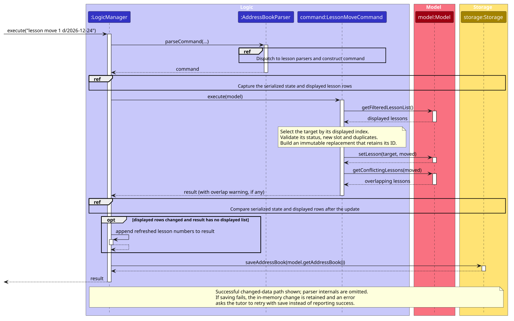

# TutorFlow Developer Guide

<!-- * Table of Contents -->
<page-nav-print />

--------------------------------------------------------------------------------------------------------------------

## **Acknowledgements**

* This project is based on the [AddressBook-Level3](https://github.com/se-edu/addressbook-level3) project created by the [SE-EDU initiative](https://se-education.org). The architecture, the command and parser design and the testing approach are adapted from it.
* Libraries used: [JavaFX](https://openjfx.io/) (user interface), [Jackson](https://github.com/FasterXML/jackson) (JSON storage), [JUnit5](https://github.com/junit-team/junit5) (testing), [Checkstyle](https://checkstyle.sourceforge.io/) and [JaCoCo](https://www.jacoco.org/jacoco/) (code quality and coverage).
* Documentation is built with [MarkBind](https://markbind.org/) and the diagrams are drawn with [PlantUML](https://plantuml.com/).

--------------------------------------------------------------------------------------------------------------------

## **Setting up, getting started**

Refer to the guide [_Setting up and getting started_](SettingUp.md).

--------------------------------------------------------------------------------------------------------------------

## **Design**

### Architecture

<puml src="diagrams/ArchitectureDiagram.puml" width="280" />

The ***Architecture Diagram*** given above explains the high-level design of the App.

The following provides a quick overview of the main components and their interactions.

**Main components of the architecture**

**`Main`** (consisting of classes [`Main`](https://github.com/AY2627S1-CS2103T-F15-1/tp/tree/master/src/main/java/seedu/address/Main.java) and [`MainApp`](https://github.com/AY2627S1-CS2103T-F15-1/tp/tree/master/src/main/java/seedu/address/MainApp.java)) is in charge of the app launch and shut down.
* At app launch, it initializes the other components in the correct sequence, and connects them up with each other.
* At shut down, it shuts down the other components and invokes cleanup methods where necessary.

The bulk of the app's work is done by the following four components:

* [**`UI`**](#ui-component): The UI of the App.
* [**`Logic`**](#logic-component): The command executor.
* [**`Model`**](#model-component): Holds the data of the App in memory.
* [**`Storage`**](#storage-component): Reads data from, and writes data to, the hard disk.

[**`Commons`**](#common-classes) represents a collection of classes used by multiple other components.

**How the architecture components interact with each other**

The *Sequence Diagram* below shows how the components interact with each other for the scenario where the user issues the command `delete 1`.

<puml src="diagrams/ArchitectureSequenceDiagram.puml" width="574" />

Each of the four main components (also shown in the diagram above),

* defines its *API* in an `interface` with the same name as the Component.
* provides its functionality through a concrete `{Component Name}Manager` class that implements the corresponding API interface.

For example, the `Logic` component defines its API in `Logic.java` and implements it in `LogicManager.java`. Other components interact with a component through its interface rather than its concrete class, preventing them from coupling to that component's implementation, as illustrated in the following partial class diagram.

<puml src="diagrams/ComponentManagers.puml" width="300" />

The sections below give more details of each component.

### UI component

The **API** of this component is specified in [`Ui.java`](https://github.com/AY2627S1-CS2103T-F15-1/tp/tree/master/src/main/java/seedu/address/ui/Ui.java)

<puml src="diagrams/UiClassDiagram.puml" alt="Structure of the UI Component"/>

The UI consists of a `MainWindow` and its parts, such as `CommandBox`, `ResultDisplay`, `PersonListPanel`, and `StatusBarFooter`. All of these, including `MainWindow`, inherit from the abstract `UiPart` class, which captures common behavior among classes that represent visible GUI parts.

The `UI` component uses the JavaFX UI framework. The layouts of these UI parts are defined in matching `.fxml` files in `src/main/resources/view`. For example, [`MainWindow.fxml`](https://github.com/AY2627S1-CS2103T-F15-1/tp/tree/master/src/main/resources/view/MainWindow.fxml) specifies the layout of [`MainWindow`](https://github.com/AY2627S1-CS2103T-F15-1/tp/tree/master/src/main/java/seedu/address/ui/MainWindow.java).

The `UI` component,

* executes user commands using the `Logic` component.
* listens for changes to `Model` data so that the UI can be updated with the modified data.
* keeps a reference to the `Logic` component, because the `UI` relies on the `Logic` to execute commands.
* depends on some classes in the `Model` component because it displays `Person` objects from the model.

### Logic component

**API** : [`Logic.java`](https://github.com/AY2627S1-CS2103T-F15-1/tp/tree/master/src/main/java/seedu/address/logic/Logic.java)

Here's a (partial) class diagram of the `Logic` component:

<puml src="diagrams/LogicClassDiagram.puml" width="550"/>

The sequence diagram below illustrates the interactions within the `Logic` component, taking `execute("delete 1")` API call as an example.

<puml src="diagrams/DeleteSequenceDiagram.puml" alt="Interactions Inside the Logic Component for the `delete 1` Command" />

<box type="info" seamless>

**Note:** The lifeline for `DeleteCommandParser` should end at the destroy marker (X), but due to a limitation of PlantUML, the lifeline continues till the end of diagram.
</box>

How the `Logic` component works:

1. When `Logic` is called upon to execute a command, the command is passed to an `AddressBookParser` object, which in turn creates a parser that matches the command (e.g., `DeleteCommandParser`) and uses it to parse the command.
1. This results in a `Command` object (more precisely, an object of one of its subclasses e.g., `DeleteCommand`) which is executed by the `LogicManager`.
1. The command can communicate with the `Model` when it is executed (e.g. to delete a person). 
   Note that although this is shown as a single step in the diagram above for simplicity, the code can require several interactions between the command object and the `Model` to complete the operation.
1. The result of the command execution is encapsulated as a `CommandResult` object which is returned from `Logic`.

Here are the other classes in `Logic` (omitted from the class diagram above) that are used for parsing a user command:

<puml src="diagrams/ParserClasses.puml" width="600"/>

How the parsing works:
* When called upon to parse a user command, the `AddressBookParser` class creates an `XYZCommandParser` (`XYZ` is a placeholder for the specific command name, e.g., `AddCommandParser`). The parser uses the other classes shown above to parse the user command and create an `XYZCommand` object (e.g., `AddCommand`). The `AddressBookParser` returns that object as a `Command` object.
* All `XYZCommandParser` classes, such as `AddCommandParser` and `DeleteCommandParser`, implement the `Parser` interface so they can be treated similarly where appropriate, for example during testing.

### Model component
**API** : [`Model.java`](https://github.com/AY2627S1-CS2103T-F15-1/tp/tree/master/src/main/java/seedu/address/model/Model.java)

<puml src="diagrams/ModelClassDiagram.puml" width="450" />

The `Model` component,

* stores the address book data i.e., all `Person` objects, each of which represents a student with a name, phone number, level, subjects and rate, and optionally an email, a venue and a remark (the `Person` objects are contained in a `UniquePersonList` object). Two `Person` objects are the same student if they have the same phone number and the same name, ignoring case.
* stores the `Lesson` objects, each of which is a lesson with a student, a subject, a date, a start time, a duration, a status and optionally a venue (the `Lesson` objects are contained in a `UniqueLessonList` object). A `Lesson` refers to its student by the student's name and phone number, which together identify a `Person`. Deleting a student deletes their lessons, and editing the name or phone number of a student keeps their lessons attached.
* stores the `Person` objects selected by the current filter, such as search results, in a separate _filtered_ list. It exposes this list as an unmodifiable `ObservableList<Person>` that the UI can observe and bind to, so the UI updates when the list changes.
* stores a `UserPrefs` object that represents the user’s preferences (currently, just the GUI settings). This is exposed to the outside as a `ReadOnlyUserPrefs` object.
* does not depend on any of the other three components (as the `Model` represents data entities of the domain, they should make sense on their own without depending on other components)

### Storage component

**API** : [`Storage.java`](https://github.com/AY2627S1-CS2103T-F15-1/tp/tree/master/src/main/java/seedu/address/storage/Storage.java)

<puml src="diagrams/StorageClassDiagram.puml" width="550" />

The `Storage` component,
* can save both address book data and user preference data in JSON format, and read them back into corresponding objects.
* is implemented by `StorageManager`, which delegates the actual JSON file access to `JsonAddressBookStorage` and `JsonUserPrefsStorage` (one class per data file).
* saves the students and the lessons in the same data file. A data file written before lessons existed has no lesson list, and still loads with no lessons.
* depends on some classes in the `Model` component (because the `Storage` component's job is to save/retrieve objects that belong to the `Model`)

### Common classes

Classes used by multiple components are in the `seedu.address.commons` package.

--------------------------------------------------------------------------------------------------------------------

## **Implementation**

This section describes some noteworthy details on how certain features are implemented.

### Lesson scheduling, agenda and conflict detection

The lesson commands are `lesson add`, `lesson repeat`, `lesson list`, `lesson move`, `lesson cancel`, `lesson done` and `lesson missed`. They share the `lesson` command word, which `AddressBookParser` hands to `LessonCommandParser`. That parser reads the next word and passes the rest of the arguments to the parser of that command. `agenda` is its own command word.

The sequence diagram below shows the successful changed-data path for `execute("lesson move 1 d/2026-12-24")`. It focuses on the Logic component; parser internals and the internal workings of Model and Storage are omitted. The command resolves the displayed index, validates and replaces the lesson, and reports overlaps without blocking the move. `LogicManager` then refreshes changed lesson numbers once and saves the updated data before returning success. A save failure retains the in-memory change and asks the tutor to retry `save`.

Diagram source: [LessonMoveSequenceDiagram.puml](diagrams/LessonMoveSequenceDiagram.puml). Regenerate the SVG with `java -jar plantuml.jar -tsvg -o ../images docs/diagrams/LessonMoveSequenceDiagram.puml` from the repository root.

How the pieces fit together:

* **Lesson indices.** `Model#getFilteredLessonList()` returns the lessons that `agenda` or `lesson list` last chose, sorted by date, then start time, then student name. `agenda` and `lesson list` number the lessons they show in that order, and `lesson move` and `lesson cancel` take the same number, so the number a tutor sees is always the one that the next command acts on. `lesson add` resets the filter so that every lesson is shown.
* **Overlaps.** `Lesson#overlaps(Lesson)` is true when both lessons are scheduled, are on the same date, and each starts before the other ends. It compares minutes since the start of the day, so back-to-back lessons are not an overlap and a lesson that ends at midnight can still be compared. `Model#getConflictingLessons(Lesson)` returns the other lessons that overlap a lesson, and `lesson add` and `lesson move` append the result to their message as a warning. `agenda` marks every lesson that has at least one overlap.
* **Cancelling.** `Lesson#cancel(String)` returns a copy with the status `CANCELLED` and the reason. The lesson is kept, so it stays in the agenda for billing, but it is no longer scheduled and so it never overlaps.
* **Immutability.** `Lesson` is immutable. `lesson move` and `lesson cancel` build a changed copy and ask the model to replace the old lesson with it, in the same way that `edit` replaces a `Person`.
* **Defaults to type less.** `lesson add` takes the subject from the student when the student has only one, uses 60 minutes if no duration is given, and uses the student's venue if no venue is given.

#### Design considerations

**Aspect: how a lesson refers to its student**

* **Alternative 1 (current choice):** store the student's name and phone number in the lesson.
    * Pros: The saved file stays flat and a lesson can be validated without loading students. A name and phone number already identify a student in TutorFlow.
    * Cons: `AddressBook` must update the lessons when it edits or deletes a student. This is done in `setPerson` and `removePerson`, so no command has to remember it.
* **Alternative 2:** store a reference to the `Person` object.
    * Pros: No update is needed when a student is edited.
    * Cons: `Person` is immutable and is replaced on every edit, so the reference would have to be replaced as well, and the saved file would need ids that students do not have.

**Aspect: what to do when lessons overlap**

* **Alternative 1 (current choice):** warn, but still schedule or move the lesson.
    * Pros: A tutor may double book on purpose, for example for a make-up lesson or two siblings. Blocking would force the tutor to delete a real lesson to record another.
    * Cons: A warning in the result box is easy to miss, so `agenda` also marks overlapping lessons.
* **Alternative 2:** reject the lesson.
    * Pros: No overlaps can exist.
    * Cons: This is overzealous validation and has no workaround.

### Lesson completion and teaching notes

`lesson done INDEX [n/NOTES]` is routed through `LessonCommandParser` to `LessonDoneCommandParser`. The parser validates the lesson index, rejects repeated `n/` prefixes and uses `ParserUtil#parseNotes` to normalise and validate optional notes. `Lesson` validates notes again at the model boundary, and `JsonAdaptedLesson` rejects invalid saved notes with an `IllegalValueException`.

`LessonDoneCommand` uses the current filtered lesson list, rejects cancelled lessons and dates after the local current date, then replaces the lesson with the immutable copy returned by `Lesson#complete`. A `Clock` can be injected into the command to test date boundaries without changing the system clock. Completing a lesson does not reset the active filter, so it can disappear from an upcoming-only list; `lesson list st/INDEX all/` includes completed lessons for later note corrections.

When notes are supplied again on a completed lesson, they replace the existing notes without creating another lesson. Omitting notes preserves them. The existing `LogicManager` save path persists the status and notes before returning success, and `view` includes these notes and the completed-lesson count.

### Missed lessons

`lesson missed INDEX` is routed through `LessonCommandParser` to `LessonMissedCommandParser`. It accepts only a positive lesson index, with no extra parameters. `LessonMissedCommand` resolves this index against the current filtered lesson list, rejects cancelled and completed lessons, and checks that the date is not later than the local current date. Like the completion command, it accepts an injected `Clock` for deterministic date-boundary tests.

The command replaces a scheduled lesson with the immutable copy returned by `Lesson#miss`, which retains all booking details, notes and identity fields. Repeating it on an already-missed lesson returns an informative message without replacing the record. Existing lesson filters, overlap checks, `view` history counts and JSON storage already support `LessonStatus.MISSED`; no new storage format is needed. A missed lesson can disappear from an upcoming-only filter, but remains accessible with `lesson list st/INDEX all/`. The existing `lesson done` command can correct a missed status to completed. `lesson move` rejects a missed lesson, because the moved copy would keep `MISSED` on its new date and the record of the missed slot would be lost. A make-up lesson is scheduled with `lesson add` instead.

`LessonMissedIntegrationTest` exercises command parsing, status changes, student history and JSON reload together. It also verifies that invalid arguments, invalid indices and rejected status/date changes leave the saved file unchanged.

### Weekly lesson series and back-dated lessons

`lesson repeat` (user story 9) and the `past/` flag of `lesson add` (user story 8) are routed through `LessonCommandParser` like the other lesson commands. `LessonRepeatCommandParser` tokenises the lesson prefixes together with `count/` and `every/`, and also tokenises `past/` so that it can reject it with a clear message, because a series starts today or later. It reads `count/` and `every/` with one pattern check, at most 3 digits, before parsing, so a huge or non-numeric value is rejected as a range error and cannot overflow.

The sequence diagram below shows `execute("lesson repeat st/1 d/2026-10-29 t/16:00 count/4")`. The parser creates the command, and the command then builds the four lessons, checks every one of them for duplicates and overlaps, and only then adds them to the model.

<puml src="diagrams/LessonRepeatSequenceDiagram.puml" alt="Interactions Inside the Logic and Model Components for the `lesson repeat` Command" />

`LessonRepeatCommand` builds every occurrence first, one per week (or every `every/` weeks) from the start date, and each is a normal `Lesson` made with `snapshotStudent`, so it records the student's id and academic level as `lesson add` does. All occurrences share one `seriesId`. The command then checks every occurrence against the existing lessons, and adds none of them if any is a duplicate. The adding itself is wrapped so that, if the model throws part-way, the occurrences added so far are deleted again. This makes the series all or nothing. An overlapping occurrence only produces a warning, which is listed for up to three occurrences and then summarised in one line. The command reports whether the displayed lesson list renumbered by comparing the displayed lessons before and after, not by guessing from the size of the list.

**The series id.** `Lesson` has an optional `seriesId` (a `UUID`, null when the lesson is not part of a series). It is copied by every method that returns a changed copy (`reschedule`, `cancel`, `complete`, `miss`, `prepare`, `withStudent`, `snapshotStudent`), so an occurrence stays in its series when it is moved or its status changes, and a later series cancel command can find every occurrence. `JsonAdaptedLesson` saves it as an optional field, so a data file written before series existed still loads. A `seriesId` that is present but is not a valid UUID, including a blank one, is rejected with `Lesson's seriesId is not a valid ID.`

**Dates.** `LessonCommandUtil` holds the date and subject checks that `lesson add`, `lesson repeat` and `lesson move` share: `requireNotInPast`, `requireNotAfterToday`, `requireNotTooFarPast`, `requireNearFuture` and `chooseSubject`. The date checks have a version that takes a `Clock`, and `LessonAddCommand` and `LessonRepeatCommand` have a constructor that takes one, in the same way as `LessonDoneCommand`, so that the boundaries (today, two years ahead and two years back) can be tested with a fixed date. With `past/`, a date after today is rejected, so that `past/` cannot create a scheduled lesson that `lesson done` would refuse.

**Not yet done.** The spec also asks for travel warnings on each occurrence. They depend on the travel-time feature and are not part of this change.

`LessonRepeatCommandTest`, `LessonRepeatCommandParserTest` and `SeriesIntegrationTest` cover the series rules, the all-or-nothing behaviour, moving and cancelling an occurrence, and saving and reloading a series.

#### Design considerations

**Aspect: how to make a series all or nothing**

* **Alternative 1 (current choice):** check every occurrence first, then add them and delete the added ones again if adding fails.
    * Pros: No partial series is ever visible to the tutor, and the check catches every duplicate before anything changes.
    * Cons: The rollback is written by hand in the command, because the model has no transaction.
* **Alternative 2:** add the occurrences one by one and stop at the first failure.
    * Pros: Simpler.
    * Cons: A tutor could be left with half a series and have to find and delete it.

### Dashboard and student overview

`today` shows the dashboard, which answers "what does today require?", and `view INDEX` shows the overview of one student. Both are read-only commands that return their whole result as text for the result box.

**Parsing.** `today` takes no parameters, so `AddressBookParser` calls `requireNoArguments` before it creates the command: `today 2` fails with `The 'today' command takes no parameters.` instead of running. `AddressBookParser` passes `LocalDate.now()` to `TodayCommand`, and `ViewCommandParser` passes it to `ViewCommand` with the parsed index. The commands do not read the clock themselves, so tests can give them a fixed date.

**Building the dashboard.** `TodayCommand#execute` gets the lessons from `Model#getAddressBook()` and returns the date followed by three sections, in this order:

* `TODAY'S LESSONS`: the lessons on that date that are not cancelled, in time order, with their count and total time in the heading. A completed or missed lesson shows its status. For each lesson, `Model#getConflictingLessons(Lesson)` decides whether to add the `⚠ overlaps` marker that `agenda` uses.
* `LESSONS AWAITING NOTES`: the scheduled lessons from earlier days, most recent first.
* `OVERDUE HOMEWORK`: `HomeworkQueries#summary(book, null, true, today)` selects every student's assigned homework that was due before today. It writes each item as `hw list` does, but without numbers, so the homework numbers that `hw list` showed still apply.

A section with nothing to show gives its own empty state, such as `No lessons today.`, instead of disappearing.

The sequence diagram below shows `execute("today")`. For simplicity, it leaves out the calls inside `HomeworkQueries#summary` and two checks that run for every command, on the input and on the displayed lesson numbers.

<puml src="diagrams/TodaySequenceDiagram.puml" alt="Interactions Inside the Logic, Model and Storage Components for the `today` Command" />

**Read-only.** `today` calls only query methods, so it changes neither the data nor the displayed lists. Before and after every command, `LogicManager` calls `Storage#snapshotAddressBook`, which turns the data into the JSON text that a save would write, without writing the file. For `today` the two snapshots are equal, so nothing is saved. The dashboard shows the data as it was when the command ran. The next command replaces it in the result box, and the tutor runs `today` again to see it up to date.

**At start-up.** `MainWindow#fillInnerParts` puts `Logic#getStartupMessage()` in the result box. `LogicManager#getStartupMessage()` returns the start-up warning, if there is one (the first-run welcome, a data file that could not be read, or a migration that could not be saved), followed by `getDashboard()`, which executes a new `TodayCommand` directly on the model, without the parser or the snapshots.

**Student overview.** `ViewCommand#execute` takes the student at `INDEX` in the displayed student list, and that student's lessons from the address book in time order. It returns five sections, in this order:

1. the student's details: `Viewing:` with the name, then the level, subjects, rate, contact details and any remark
1. `NEXT LESSON`: the first scheduled lesson from today onwards, with any preparation notes
1. `RECENT LESSON NOTES`: the three most recent notes of completed lessons, newest first
1. `LESSON HISTORY`: the numbers of completed, cancelled and missed lessons
1. `OUTSTANDING HOMEWORK`: `HomeworkQueries#summary(book, studentId, false, today)` selects the student's homework that is not yet reviewed, overdue first

Like the dashboard, the overview gives an empty state for a section with nothing to show. It does not change the displayed student list, so the numbers used by other commands stay the same.

More sections are planned: dues from the ledger after `OVERDUE HOMEWORK` on the dashboard, a balance between `LESSON HISTORY` and `OUTSTANDING HOMEWORK` in the overview, and travel warnings in `TODAY'S LESSONS`. None of them exists yet. Each is meant to plug in the same way, as another read-only query on the address book whose text the command adds at its position in the order.

#### Design considerations

**Aspect: where the text of the dashboard is built**

* **Alternative 1 (current choice):** the command builds its own text, and takes the homework section from `HomeworkQueries`, a shared query class in the model whose selection and formatting rules `view` and `hw list` also use.
    * Pros: The order of the sections is in one place: `TodayCommand#execute` joins them in the order they are shown. `today`, `view` and `hw list` share the homework rules, so they cannot drift apart.
    * Cons: The result is a single string. Another display, such as a panel beside the student list, would need the sections as data instead.
* **Alternative 2:** a separate dashboard class that collects a section from each feature.
    * Pros: A new feature adds its section without editing `TodayCommand`.
    * Cons: The sections and their order are fixed, so for a few sections the extra class adds indirection without removing code.

### Homework status and deletion

Homework commands take a number from the last `hw list`. `HomeworkCommandSupport#target` resolves that number against the snapshot that `Model#getDisplayedHomework()` returns, and then finds the item again in the address book by its id, so a number never selects another item.

The sequence diagram below shows `execute("hw status 2 s/submitted")`.

<puml src="diagrams/HomeworkStatusSequenceDiagram.puml" alt="Interactions Inside the Logic, Model and Storage Components for the `hw status 2 s/submitted` Command" />

The activity diagram below shows what `hw delete INDEX [confirm]` does. Homework that has feedback is only deleted when `confirm` is given.

<puml src="diagrams/HomeworkDeleteActivityDiagram.puml" alt="Activity Diagram for the `hw delete INDEX [confirm]` Command" />

### Archiving and deleting students

`archive INDEX` and `restore INDEX` replace a student with a copy whose archived flag is changed, so the lessons and homework of the student are kept. The default student list hides archived students. `delete INDEX` removes a student together with their lessons, homework and financial events, and asks for `confirm` first when the student has any.

The sequence diagram below shows `execute("archive 1")`.

<puml src="diagrams/ArchiveSequenceDiagram.puml" alt="Interactions Inside the Logic, Model and Storage Components for the `archive 1` Command" />

The activity diagram below shows what `delete INDEX [confirm]` does.

<puml src="diagrams/DeleteStudentActivityDiagram.puml" alt="Activity Diagram for the `delete INDEX [confirm]` Command" />

### Undo/redo feature

#### Current Implementation
The current ModelManager implementation adds three fields.
`lastState` and `newState` - store `AddressBook`s track of state before and after a destructive operation.
`lastDestructiveAction` keeps track of the type of destructive action, for reporting to the user.

* `lastState` is used to restore the destructive action after an `undo` call.
* `newState` is used to check if actions have actually changed the state, and to reset `lastDestructiveAction` if so, disabling `undo`. This prevents multiple changes from inadvertently being removed at once with `undo`.

`lastState`, `newState`, and `lastDestructiveAction` are updated on each destructive action using `wrapDestructiveAction`, as shown below.

<puml src="diagrams/UndoCurrentImplementationWrapperSequenceDiagram.puml" alt="Sequence diagram for destructive action supporting Undo" />

This wrapper keeps `lastState`, `newState`, and `lastDestructiveAction` consistent and ensures that the state is only saved if the destructive action succeeds.

#### Proposed Implementation

The proposed undo/redo mechanism is facilitated by `VersionedAddressBook`. It extends `AddressBook` with an undo/redo history, stored internally as an `addressBookStateList` and `currentStatePointer`. Additionally, it implements the following operations:

* `VersionedAddressBook#commit()` -- Saves the current address book state in its history.
* `VersionedAddressBook#undo()` -- Restores the previous address book state from its history.
* `VersionedAddressBook#redo()` -- Restores a previously undone address book state from its history.

These operations are exposed in the `Model` interface as `Model#commitAddressBook()`, `Model#undoAddressBook()` and `Model#redoAddressBook()` respectively.

Given below is an example usage scenario and how the undo/redo mechanism behaves at each step.

Step 1. The user launches the application for the first time. The `VersionedAddressBook` will be initialized with the initial address book state, and the `currentStatePointer` pointing to that single address book state.

<puml src="diagrams/UndoRedoState0.puml" alt="UndoRedoState0" />

Step 2. The user executes `delete 5` command to delete the 5th person in the address book. The `delete` command calls `Model#commitAddressBook()`, causing the modified state of the address book after the `delete 5` command executes to be saved in the `addressBookStateList`, and the `currentStatePointer` is shifted to the newly inserted address book state.

<puml src="diagrams/UndoRedoState1.puml" alt="UndoRedoState1" />

Step 3. The user executes `add n/David …​` to add a new person. The `add` command also calls `Model#commitAddressBook()`, causing another modified address book state to be saved into the `addressBookStateList`.

<puml src="diagrams/UndoRedoState2.puml" alt="UndoRedoState2" />

<box type="info" seamless>

**Note:** If a command fails its execution, it will not call `Model#commitAddressBook()`, so the address book state will not be saved into the `addressBookStateList`.
</box>

Step 4. The user now decides that adding the person was a mistake, and decides to undo that action by executing the `undo` command. The `undo` command will call `Model#undoAddressBook()`, which will shift the `currentStatePointer` once to the left, pointing it to the previous address book state, and restores the address book to that state.

<puml src="diagrams/UndoRedoState3.puml" alt="UndoRedoState3" />

<box type="info" seamless>

**Note:** If the `currentStatePointer` is at index 0, pointing to the initial AddressBook state, then there are no previous AddressBook states to restore. The `undo` command uses `Model#canUndoAddressBook()` to check if this is the case. If so, it will return an error to the user rather
than attempting to perform the undo.
</box>

The following sequence diagram shows how an undo operation goes through the `Logic` component:

<puml src="diagrams/UndoSequenceDiagram-Logic.puml" alt="UndoSequenceDiagram-Logic" />

<box type="info" seamless>

**Note:** The lifeline for `UndoCommand` should end at the destroy marker (X), but due to a limitation of PlantUML, it continues to the end of the diagram.
</box>

Similarly, how an undo operation goes through the `Model` component is shown below:

<puml src="diagrams/UndoSequenceDiagram-Model.puml" alt="UndoSequenceDiagram-Model" />

The `redo` command does the opposite — it calls `Model#redoAddressBook()`, which shifts the `currentStatePointer` once to the right, pointing to the previously undone state, and restores the address book to that state.

<box type="info" seamless>

**Note:** If the `currentStatePointer` is at index `addressBookStateList.size() - 1`, pointing to the latest address book state, then there are no undone AddressBook states to restore. The `redo` command uses `Model#canRedoAddressBook()` to check if this is the case. If so, it will return an error to the user rather than attempting to perform the redo.
</box>

Step 5. The user then decides to execute the command `list`. Commands that do not modify the address book, such as `list`, will usually not call `Model#commitAddressBook()`, `Model#undoAddressBook()` or `Model#redoAddressBook()`. Thus, the `addressBookStateList` remains unchanged.

<puml src="diagrams/UndoRedoState4.puml" alt="UndoRedoState4" />

Step 6. The user executes `clear`, which calls `Model#commitAddressBook()`. Since the `currentStatePointer` is not pointing at the end of the `addressBookStateList`, all address book states after the `currentStatePointer` will be purged. Reason: It no longer makes sense to redo the `add n/David …` command. This is the behavior that most modern desktop applications follow.

<puml src="diagrams/UndoRedoState5.puml" alt="UndoRedoState5" />

The following activity diagram summarizes what happens when a user executes a new command:

<puml src="diagrams/CommitActivityDiagram.puml" width="250" />

#### Design considerations:

**Aspect: How undo & redo execute:**

* **Alternative 1 (current choice):** Saves the entire address book.
  * Pros: Easy to implement.
  * Cons: May have performance issues in terms of memory usage.

* **Alternative 2:** Individual command knows how to undo/redo by
  itself.
  * Pros: Will use less memory (e.g. for `delete`, just save the person being deleted).
  * Cons: We must ensure that the implementation of each individual command is correct.

--------------------------------------------------------------------------------------------------------------------

## **Documentation, logging, testing, dev-ops**

### Student balances and dues

`LedgerEntry` is immutable and records its UUID, permanent student UUID, optional lesson UUID, kind,
positive exact `BigDecimal` amount and date. Charges require a lesson UUID; payments have none.
`AddressBook` owns the unmodifiable list and validates student/lesson references, unique entry IDs,
and at most one charge per lesson. Profile edits never rewrite financial records. Copy/reset,
equality, student deletion, clear, and the real JSON snapshot include both finance and homework.

`LessonDoneCommand` explicitly calls `Model.chargeLesson(target, completedLesson)` on first completion.
This operation validates the charge, replaces the lesson and records the charge atomically, returning
`Optional<LedgerEntry>` for the command's success text. A zero rounded fee returns no charge. The general
`setLesson` operation only updates lesson data; it never bills implicitly. Existing completed notes
use `setLesson`, so note corrections do not bill again. Fees use the current hourly rate × duration
in minutes ÷ 60, rounded once with `RoundingMode.HALF_UP`, and retain the permanent lesson UUID.
The command translates model validation failures to `CommandException` and gives an accurate zero-fee
message without directing users to a manual charge command that is not implemented yet.

Ledger copy/reset and JSON restoration validate records in one pass using student/lesson maps and
sets of entry IDs and charged lesson IDs. The ledger validation cost is O(students + lessons + entries),
rather than scanning the growing list once per entry. Other domains keep their existing uniqueness checks.
`getLedgerEntries` returns one cached immutable live wrapper. Individual insertions remain validated.
`removeLesson` refuses to delete a billed lesson, including detached equal-value lookup, so a saved
charge cannot point at a deleted lesson. Student deletion still cascades all of that student's history.

`Ledger.balance(book, student)` adds charges and subtracts payments, returning a negative value for credit.
`Ledger.describeBalance(amount)` shares the `OUTSTANDING $X.XX` / `IN CREDIT $X.XX` labels.
`Ledger.dues(book, today)` returns immutable `Due(student, amount, oldestUnpaidDate)` rows, oldest first,
breaking ties by name then phone. Payments cover charges FIFO by charge date, including partial payments
and advance credit. The supplied date is the reference for displaying unpaid ages, not a cutoff that
excludes transactions. `Ledger.formatDues(book, today)` formats what `dues` prints: the DUES header, count and
total, then each debtor, marked `(archived)` if archived, with the age of their oldest unpaid charge (`1 day`,
`2 days`), or only the up-to-date message when nobody owes money. `today` shows this text as its DUES section
and adds the header above the up-to-date message. `view` shows `describeBalance` of the student's balance under
BALANCE. Credit from one account never reduces another student's debt. Queries include archived/filtered
students and never mutate data.

`BalanceCommand` parses `balance st/INDEX` and reports the displayed student's current summary;
running account statements from alpha §4.29 are deliberately deferred. `DuesCommand` reports all debtors
with shared wording, including `(archived)` and the singular `1 day`.

`PaymentCommandParser` parses `pay st/INDEX amt/AMOUNT [d/DATE] [n/NOTES]`, requiring a positive decimal
amount with at most two fractional digits and no currency symbol. Dates use the shared `ParserUtil.parseDate`
rules (ISO, D/M/YYYY and today/tmr resolved against the injected clock); the command
rejects future dates. Notes are optional 1–200 printable one-line characters and persist in the JSON
adapter; absent notes in existing finance files default to null. Missing JSON fields are named in errors.
The response confirms the amount, student, date and updated balance. Payment list/reverse, manual charge,
and running account statements are follow-up increments; no success message points to unavailable commands.

Integration follow-ups before full alpha sign-off:
* Finance: introduce reversal records and a schema migration before implementing payment/charge reversal.
  A charge currently uses the lesson UUID, so recharging after reversal requires a new event identity design.
* Finance: implement the running account statement in specification section 4.29.
* Lesson move/cancel and series cancellation (#142): check active charges before changing a billed lesson.
  Preserve lesson and series UUIDs across every copy operation.
* Task integration: include linked task counts in student deletion once the task domain is implemented.

`LogicManager(Model, Storage, Clock)` passes a shared date source to the finance and relevant lesson
parsers/commands. Interactive constructors default to the system clock. Finance workflow tests use a
fixed Singapore clock, including scheduling/completion and payment, and cover a UTC/local-date boundary.
The snapshot/save flow persists every recorded payment. After a failed save, `save` retries without
recording another payment. Repeating `pay` intentionally adds another entry. Student filters do not change.

Student edits retain permanent financial references without changing amounts. Confirmed student deletion removes their
records and prompts even when they only have payment records and no lessons. Clearing data removes the ledger too.
`JsonAdaptedLedgerEntry` and the optional `ledgerEntries` collection in `JsonSerializableAddressBook` persist every
record. Loading validates IDs, amounts and student references. Older files load an empty ledger: completed lessons
are not billed retroactively, because their historical rate and payment state are unknown.

* [Documentation guide](Documentation.md)
* [Testing guide](Testing.md)
* [Logging guide](Logging.md)
* [DevOps guide](DevOps.md)

--------------------------------------------------------------------------------------------------------------------

## **Appendix: Requirements**

### Product scope

**Target user profile**:

* is an independent private tutor who teaches multiple students (around 20)
* teaches at several venues (students' homes, cafés and online), often with short travel gaps between lessons
* currently tracks lessons, homework, lesson notes and fees across calendars, chat apps, notebooks and spreadsheets
* prefers desktop apps over other types of applications, and works from a laptop between lessons
* can type fast and prefers typing to mouse interactions
* is reasonably comfortable using CLI apps
* is unwilling to spend a lot of time migrating existing data

**Value proposition**: TutorFlow gives a private tutor one place to organise and access information about their students, lessons, homework and payments. It answers "what does today require, what does each student need, and who still owes me" fast enough to use in the fifteen minutes between two lessons, which is faster than tracking the same information across spreadsheets, chats, calendars and personal notes.

### User stories

Priorities: High (must have) - `* * *`, Medium (nice to have) - `* *`, Low (unlikely to have) - `*`

**Student management**

| Priority | As a …                                    | I want to …                                                                                          | So that I can…                                                                               |
|----------|--------------------------------------------|-------------------------------------------------------------------------------------------------------|-----------------------------------------------------------------------------------------------|
| `* * *`  | private tutor                              | create a student profile with contact details, subjects, academic level and lesson rate               | keep the information needed to teach them in one place                                        |
| `* * *`  | private tutor                              | view a student overview with their next lesson, outstanding homework, recent lesson notes and unpaid balance | prepare for the student without checking multiple sections                             |
| `* * *`  | private tutor                              | search for students by name                                                                           | access a student's record quickly                                                             |
| `* *`    | private tutor                              | filter students by subject or academic level                                                          | find relevant groups of students                                                              |
| `* * *`  | private tutor                              | update a student's profile                                                                            | keep their information accurate when their circumstances change                               |
| `*`      | private tutor                              | archive a student who has stopped taking lessons                                                      | keep them out of my active list while their teaching and payment history remains available    |
| `* * *`  | private tutor                              | be warned about a possible duplicate when creating a student                                          | avoid maintaining multiple records for the same person                                        |

**Lesson scheduling**

| Priority | As a …                                    | I want to …                                                                                          | So that I can…                                                                               |
|----------|--------------------------------------------|-------------------------------------------------------------------------------------------------------|-----------------------------------------------------------------------------------------------|
| `* * *`  | private tutor                              | schedule a lesson with its student, subject, date, time, duration and venue                           | have all the information needed to conduct the lesson                                         |
| `* *`    | private tutor                              | schedule recurring lessons                                                                            | avoid entering regular weekly lessons individually                                            |
| `* * *`  | private tutor                              | view my lessons in a daily or weekly agenda                                                           | plan my teaching schedule and travel                                                          |
| `* * *`  | private tutor                              | view all upcoming lessons for a specific student                                                      | review my commitments with them                                                               |
| `* * *`  | private tutor                              | reschedule a lesson while retaining its existing details                                              | record timetable changes efficiently                                                          |
| `* * *`  | private tutor                              | cancel a lesson and record its cancellation status                                                    | keep my schedule and payment records accurate                                                 |
| `* * *`  | private tutor                              | be warned when a lesson conflicts with another commitment                                             | avoid double-booking myself                                                                   |
| `*`      | travelling tutor                           | see consecutive lessons with insufficient travel time between their venues                            | identify schedules that may be impractical                                                    |
| `* * *`  | private tutor                              | mark a lesson as completed, cancelled or missed                                                       | have an accurate record of what happened                                                      |
| `* * *`  | private tutor                              | record preparation notes before a lesson and teaching notes afterward                                 | continue effectively from one lesson to the next                                              |

**Homework management**

| Priority | As a …                                    | I want to …                                                                                          | So that I can…                                                                               |
|----------|--------------------------------------------|-------------------------------------------------------------------------------------------------------|-----------------------------------------------------------------------------------------------|
| `* *`    | private tutor                              | assign homework to a student with a description and due date                                          | know what the student is expected to complete                                                 |
| `* *`    | private tutor                              | view all outstanding and overdue homework across my students                                          | identify which students require follow-up                                                     |
| `* *`    | private tutor                              | update homework as assigned, submitted, reviewed or overdue                                           | see its current status at a glance                                                            |
| `* *`    | private tutor                              | edit an assignment's details                                                                          | correct mistakes or accommodate changes                                                       |
| `* *`    | private tutor                              | record feedback on submitted homework                                                                 | remember the issues to discuss during the next lesson                                         |
| `*`      | private tutor                              | view a student's homework history                                                                     | identify patterns in their completion and progress                                            |

**Payments**

| Priority | As a …                                    | I want to …                                                                                          | So that I can…                                                                               |
|----------|--------------------------------------------|-------------------------------------------------------------------------------------------------------|-----------------------------------------------------------------------------------------------|
| `* *`    | private tutor                              | record the fee charged for each completed lesson                                                      | calculate what each student owes                                                              |
| `* *`    | private tutor                              | record a payment and associate it with the relevant student                                           | keep their balance accurate                                                                   |
| `* *`    | private tutor                              | view each student's charges, payments and current balance                                             | answer payment questions clearly                                                              |
| `* *`    | private tutor                              | view all outstanding payments ordered by how long they have been unpaid                               | prioritise payment follow-ups                                                                 |
| `* *`    | private tutor                              | correct or reverse an incorrectly entered payment                                                     | prevent errors from permanently distorting my records                                         |
| `*`      | private tutor                              | export payment records for a selected period                                                          | use them for accounting and tax reporting                                                     |

**Daily workflow**

| Priority | As a …                                    | I want to …                                                                                          | So that I can…                                                                               |
|----------|--------------------------------------------|-------------------------------------------------------------------------------------------------------|-----------------------------------------------------------------------------------------------|
| `* * *`  | private tutor                              | view a dashboard showing today's lessons, overdue homework and outstanding payments                   | know what requires my attention                                                               |
| `*`      | private tutor                              | create follow-up tasks linked to students, lessons, homework or payments                              | make sure important actions are not forgotten                                                 |
| `* *`    | private tutor                              | undo a recent destructive action                                                                      | recover from an accidental change                                                             |
| `* * *`  | new user                                   | access in-app guidance and examples                                                                   | learn TutorFlow without relying on external documentation                                     |
| `*`      | new user                                   | experiment with sample records and remove them when I am ready                                        | learn the application before entering real information                                        |
| `*`      | private tutor moving from another tracking system | import student records from a common file format                                               | avoid re-entering all my existing information manually                                        |

### Use cases

(For all use cases below, the **System** is `TutorFlow` and the **Actor** is the `tutor`, unless specified otherwise)

**Use case: UC1 - Add a student**

**MSS**

1.  Tutor requests to add a student, providing the student's name, phone number, level, subject(s) and lesson rate, and optionally an email and usual venue
2.  TutorFlow adds the student and confirms the addition

    Use case ends.

**Extensions**

* 1a. A required detail is missing or invalid.

    * 1a1. TutorFlow shows an error message stating which detail is wrong and the accepted format.

      Use case resumes at step 1.

* 1b. A student with the same name and phone number already exists.

    * 1b1. TutorFlow rejects the request and tells the tutor that the student already exists.

      Use case ends.

* 1c. A student with the same name but a different phone number already exists.

    * 1c1. TutorFlow adds the student and warns the tutor that another student has the same name.

      Use case ends.

* 2a. The data cannot be saved to disk.

    * 2a1. TutorFlow tells the tutor that the change was applied in this session but could not be saved.

      Use case ends.

**Use case: UC2 - Schedule a lesson**

**MSS**

1.  Tutor requests to list students
2.  TutorFlow shows a list of students
3.  Tutor requests to schedule a lesson for a specific student, providing the subject, date, time and duration, and optionally a venue
4.  TutorFlow adds the lesson and shows its details

    Use case ends.

**Extensions**

* 2a. The list is empty.

  Use case ends.

* 3a. The given student does not exist.

    * 3a1. TutorFlow shows an error message.

      Use case resumes at step 2.

* 3b. A lesson detail is invalid, for example a date in the past or a lesson that would run past midnight.

    * 3b1. TutorFlow shows an error message stating which detail is wrong.

      Use case resumes at step 3.

* 3c. The subject is not one of the subjects the student is recorded as taking.

    * 3c1. TutorFlow shows an error message.

      Use case resumes at step 3.

* 3d. An identical lesson already exists.

    * 3d1. TutorFlow rejects the request and tells the tutor that the lesson already exists.

      Use case ends.

* 4a. The new lesson overlaps another scheduled lesson.

    * 4a1. TutorFlow keeps the newly scheduled lesson and warns the tutor of the overlapping lesson.

      The warning does not reject the scheduling request. See **Overlap** in the glossary for the conflict boundary; back-to-back lessons do not overlap.

      Use case ends.

**Use case: UC3 - Reschedule a lesson**

**MSS**

1.  Tutor requests to view the lessons of a specific student
2.  TutorFlow shows a numbered list of the student's lessons
3.  Tutor requests to reschedule a specific lesson, providing the new date, time, duration and/or venue
4.  TutorFlow updates the lesson, keeping the details that were not changed, and shows the old and new details

    Use case ends.

**Extensions**

* 2a. The student has no lessons.

  Use case ends.

* 3a. The given lesson does not exist in the list.

    * 3a1. TutorFlow shows an error message.

      Use case resumes at step 2.

* 3b. The lesson is already completed or cancelled.

    * 3b1. TutorFlow tells the tutor that the lesson can no longer be rescheduled.

      Use case ends.

* 3c. The new date or time is invalid, for example a date in the past.

    * 3c1. TutorFlow shows an error message stating which detail is wrong.

      Use case resumes at step 3.

* 4a. The new time overlaps another scheduled lesson.

    * 4a1. TutorFlow keeps the updated lesson details and warns the tutor of the overlapping lesson.

      The warning does not undo the rescheduling request. Only scheduled lessons are considered for overlap, as defined in the glossary.

      Use case ends.

**Use case: UC4 - Record the outcome of a lesson**

**MSS**

1.  Tutor requests to view the agenda for a day
2.  TutorFlow shows the lessons on that day
3.  Tutor requests to mark a specific lesson as completed, and provides teaching notes
4.  TutorFlow marks the lesson as completed, saves the notes and confirms the update

    Use case ends.

**Extensions**

* 2a. There are no lessons on that day.

  Use case ends.

* 3a. The given lesson does not exist in the list.

    * 3a1. TutorFlow shows an error message.

      Use case resumes at step 2.

* 3b. The lesson is cancelled, or is scheduled for a future date.

    * 3b1. TutorFlow tells the tutor that the lesson cannot be marked as completed.

      Use case ends.

* 3c. The lesson is already completed.

    * 3c1. TutorFlow replaces the existing notes with the new notes and confirms the update.

      Use case ends.

* 3d. The tutor requests to mark the lesson as missed instead.

    * 3d1. TutorFlow marks the lesson as missed and confirms the update.

      Use case ends.

**Use case: UC5 - Assign homework and record feedback**

**MSS**

1.  Tutor requests to assign homework to a specific student, providing a description and a due date
2.  TutorFlow records the homework as assigned and confirms the addition
3.  Tutor requests to mark the homework as submitted
4.  TutorFlow updates the status of the homework
5.  Tutor requests to record feedback on the homework
6.  TutorFlow saves the feedback and confirms the update

    Use case ends.

**Extensions**

* 1a. The description is empty or the due date is invalid or in the past.

    * 1a1. TutorFlow shows an error message stating which detail is wrong.

      Use case resumes at step 1.

* 1b. The student already has identical homework with the same due date.

    * 1b1. TutorFlow rejects the request and tells the tutor that the homework already exists.

      Use case ends.

* 3a. The given homework does not exist.

    * 3a1. TutorFlow shows an error message.

      Use case resumes at step 3.

* 5a. The homework has not been submitted.

    * 5a1. TutorFlow tells the tutor that feedback can only be recorded on submitted homework.

      Use case resumes at step 3.

**Use case: UC6 - Record a payment and check a student's balance**

**MSS**

1.  Tutor requests to record a payment from a specific student, providing the amount and optionally the date and notes
2.  TutorFlow records the payment against the student and shows the student's updated balance
3.  Tutor requests to view the student's account
4.  TutorFlow shows the student's charges, payments and running balance

    Use case ends.

**Extensions**

* 1a. The student does not exist.

    * 1a1. TutorFlow shows an error message.

      Use case resumes at step 1.

* 1b. The amount is not a positive number or the date is in the future.

    * 1b1. TutorFlow shows an error message stating which detail is wrong.

      Use case resumes at step 1.

* 2a. The payment is larger than the amount the student owes.

    * 2a1. TutorFlow records the payment and shows that the student is in credit.

      Use case resumes at step 3.

**Use case: UC7 - Delete a student**

**MSS**

1.  Tutor requests to list students
2.  TutorFlow shows a list of students
3.  Tutor requests to delete a specific student in the list
4.  TutorFlow tells the tutor which lessons, homework and payment records will be deleted along with the student, and asks for confirmation
5.  Tutor confirms the deletion
6.  TutorFlow deletes the student and all of their records, and confirms the deletion

    Use case ends.

**Extensions**

* 2a. The list is empty.

  Use case ends.

* 3a. The given index is invalid.

    * 3a1. TutorFlow shows an error message.

      Use case resumes at step 2.

* 4a. The student has no lessons, homework or payments.

    * 4a1. TutorFlow deletes the student without asking for confirmation.

      Use case ends.

* 5a. The tutor does not confirm the deletion.

    * 5a1. TutorFlow keeps the student and all of their records.

      Use case ends.

**Use case: UC8 - Prepare for the day and for a lesson**

**MSS**

1.  Tutor opens TutorFlow
2.  TutorFlow loads the saved data and shows the dashboard, listing today's lessons, lessons awaiting notes, overdue homework and outstanding payments
3.  Tutor requests to view the overview of a specific student
4.  TutorFlow shows the student's details, next lesson, recent lesson notes, outstanding homework and unpaid balance

    Use case ends.

**Extensions**

* 2a. There is no saved data.

    * 2a1. TutorFlow starts with an empty data set and shows a welcome message.

      Use case ends.

* 2b. The saved data cannot be read.

    * 2b1. TutorFlow keeps the unreadable file aside, starts with an empty data set and warns the tutor.

      Use case ends.

* 3a. The given student does not exist.

    * 3a1. TutorFlow shows an error message.

      Use case resumes at step 3.

### Non-Functional Requirements

1.  Should work on any _mainstream OS_ as long as it has Java `25` or above installed.
2.  Should work fully offline, and should not make any network connections.
3.  Should be able to hold up to 200 students and 10,000 lessons without noticeable sluggishness in performance for typical usage.
4.  Searching, listing and viewing commands should show their results within 1 second on a typical laptop with the data set size in NFR 3.
5.  Should start up and show the dashboard within 5 seconds on a typical laptop with the data set size in NFR 3.
6.  A user with above average typing speed for regular English text (i.e. not code, not system admin commands) should be able to accomplish most of the tasks faster using commands than using the mouse.
7.  Should save every change to disk before reporting that the command succeeded, so that no data is lost when the application is closed normally or when it is terminated after a command has completed.
8.  Should validate all user input before storing it, and should reject invalid dates, times, amounts and contact details with a message that names the invalid field and the accepted format.
9.  Should ask for confirmation before permanently deleting a student who has lessons, homework or payments, and before clearing all data.
10. Should store all data only in a local file on the user's computer, and should not write students' contact details or fees to log files.
11. Should store data in a human-readable text format that is documented in the Developer Guide, so that a tutor can back up the data by copying the data file.
12. Should be able to load any data file saved by an earlier version of the same major version.
13. Should be usable on screens with a resolution of 1280x720 and higher.
14. Is for a single user only, and does not need to support several users editing the same data file.

### Glossary

* **Mainstream OS**: Windows, Linux, Unix, or macOS
* **Tutor**: The user of TutorFlow, an independent private tutor who teaches multiple students
* **Student**: A person the tutor teaches, recorded with contact details, academic level, subjects, lesson rate and an optional usual venue
* **Level**: A student's academic level in the Singapore education system: `P1` to `P6` (primary), `S1` to `S5` (secondary) or `J1` to `J2` (junior college)
* **Rate**: The amount a student is charged for one hour of lesson, in Singapore dollars (SGD)
* **Duplicate student**: A student with the same name and phone number as another student, after ignoring letter case and extra spaces
* **Lesson**: A teaching session with one student, with a subject, date, start time, duration and venue
* **Lesson status**: The state of a lesson: _scheduled_ (has not happened yet), _completed_ (took place), _cancelled_ (called off in advance) or _missed_ (the student did not attend)
* **Overlap**: Two scheduled lessons on the same date whose time ranges share at least one minute. Lessons that end exactly when the next one starts do not overlap
* **Agenda**: A view of the tutor's lessons in time order for a day or a week
* **Dashboard**: The view shown on startup that lists what needs the tutor's attention today, such as today's lessons, lessons awaiting notes, overdue homework and outstanding payments
* **Student overview**: A single view of a student's details, next lesson, recent lesson notes, outstanding homework and unpaid balance
* **Lesson notes**: Free text that the tutor records about a lesson, such as what was covered and what the student needs to improve
* **Homework status**: The state of a homework item: _assigned_, _submitted_ or _reviewed_. Homework that is still assigned after its due date is _overdue_
* **Charge**: The fee for one completed lesson, calculated from the student's rate and the lesson duration unless the tutor specifies another amount
* **Payment**: Money received from a student, recorded against the student rather than against a particular lesson
* **Balance**: The total charges minus the total payments of a student. A positive balance is _outstanding_, and a negative balance means the student is _in credit_
* **Index**: The position of an item in the list currently shown on screen, used by commands to refer to that item
* **Prefix**: A short label ending in `/`, such as `n/` or `d/`, that marks the start of a command parameter
* **Data file**: The local file in which TutorFlow saves all of its data

--------------------------------------------------------------------------------------------------------------------

## **Appendix: Instructions for manual testing**

Given below are instructions to test the app manually.

<box type="info" seamless>

**Note:** These instructions only provide a starting point for testers to work on;
testers are expected to do more *exploratory* testing.
</box>

### Launch and shutdown

1. Initial launch

   1. Download the JAR file and copy it into an empty folder.

   1. Double-click the JAR file. 
      Expected: The GUI opens empty with welcome and demo instructions. The window size may not be optimal.

1. Saving window preferences

   1. Resize the window to an optimal size. Move the window to a different location. Close the window.

   1. Relaunch the app by double-clicking the JAR file. 
       Expected: The most recent window size and location are retained.

### Deleting a person

1. Deleting a person while all persons are being shown

   1. Prerequisites: List all persons using the `list` command, with multiple persons in the list.

   1. Test case: `delete 1` 
      Expected: The first contact is deleted from the list. The status message shows the deleted contact's details.

   1. Test case: `delete 0` 
      Expected: No person is deleted. The status message shows error details.

   1. Other incorrect delete commands to try: `delete`, `delete x`, `...` (where x is larger than the list size) 
      Expected: Similar to previous.

### Lessons

1. Scheduling a lesson

   1. Prerequisites: Use `list`, with at least two students in the list. The 1st student takes one subject and the 2nd student takes more than one.

   1. Test case: `lesson add st/1 d/<a date next week> t/16:30 dur/90` 
      Expected: A lesson is scheduled in the student's only subject at the student's venue. The result shows `Scheduled: ...`.

   1. Test case: the same command again 
      Expected: The lesson is rejected as an exact duplicate.

   1. Test case: `lesson add st/2 d/<the same date> t/17:00` (without `s/`) 
      Expected: Rejected, because the student takes several subjects. The result names the subjects.

   1. Test case: `lesson add st/2 s/<a subject of the student> d/<the same date> t/17:00` 
      Expected: Scheduled, and the result warns that it overlaps the first lesson.

   1. Other incorrect commands to try: `lesson add st/1 d/2020-01-01 t/16:30` (past date), `lesson add st/1 d/<next week> t/23:00 dur/120` (past midnight), `lesson add st/0 d/<next week> t/16:30`, `lesson add st/1` 
      Expected: Nothing is scheduled. The result shows an error message.

1. Scheduling a weekly series

   1. Prerequisites: Use `list`, with at least one student who takes one subject.

   1. Test case: `lesson repeat st/1 d/<a date next week> t/16:00 count/4` 
      Expected: The result says `Scheduled 4 weekly occurrences.` and, on the next line, that the new lessons are not in the displayed list. `lesson list st/1` then shows 4 lessons, each with the student's level at booking.

   1. Test case: `lesson repeat st/1 d/<a date next week> t/16:00 count/4 past/` 
      Expected: Rejected with a message that `past/` is not accepted for a series.

   1. Test case: `lesson repeat st/1 d/<a date next week> t/16:00 count/53` 
      Expected: Rejected with the range message for `count/` and `every/`.

   1. Test case: `lesson add st/1 d/<a date next week> t/09:00 past/` 
      Expected: Rejected, because `past/` is only for a lesson that has already taken place. Using a date from last week succeeds.

1. Viewing lessons

   1. Prerequisites: Schedule the two lessons above.

   1. Test case: `agenda d/<the same date>` 
      Expected: Both lessons are listed in time order, each marked `⚠ overlaps`.

   1. Test case: `agenda week/ d/<the same date>` 
      Expected: Seven days are shown, and days without lessons show `— no lessons —`.

   1. Test case: `agenda week/yes` 
      Expected: An error that the flag takes no value.

   1. Test case: `lesson list st/1` 
      Expected: The upcoming lessons of the 1st student are listed and numbered.

1. Rescheduling and cancelling a lesson

   1. Prerequisites: Run `agenda` for the date of the lessons, so that the lessons are numbered.

   1. Test case: `lesson move 1 t/20:00` 
      Expected: The 1st lesson moves to 20:00 and keeps its subject and venue. The result shows the old and the new slot.

   1. Test case: `lesson move 1` 
      Expected: An error that at least one of `d/`, `t/`, `dur/` or `v/` is needed.

   1. Test case: `lesson cancel 1 r/Student unwell` 
      Expected: The lesson is cancelled with its reason. Run `agenda` again to see it listed as cancelled and no longer overlapping.

   1. Test case: `lesson cancel 1` again, then `lesson move 1 d/<next week>` 
      Expected: Both are rejected because the lesson is already cancelled.

   1. Test case: `lesson cancel 99` 
      Expected: An error that the lesson index is invalid.

1. Completing a lesson

   1. Prerequisites: Schedule a lesson dated today, then run `agenda` and note its lesson number.

   1. Test case: `lesson done INDEX n/Covered algebra` 
      Expected: `Completed: ...`. Run `view STUDENT_INDEX` to see the notes and completed count. Reopen the app and check they are still present.

   1. Test case: Run `lesson list st/STUDENT_INDEX all/`, check the current lesson number, then run `lesson done INDEX n/Revised notes` followed by `lesson done INDEX` 
      Expected: Notes change to `Revised notes`, then remain unchanged. No extra lesson is created.

   1. Other incorrect commands to try: completion of a future or cancelled lesson, `lesson done 0`, `lesson done INDEX n/`, or `lesson done INDEX n/First n/Second` 
      Expected: Rejected without changing the lesson or notes.

### Saving data

1. Dealing with missing/corrupted data files

   1. Prerequisites: Close TutorFlow, then open `data/tutorflow-v14.json` and damage it, for example by deleting its last `}`.

   1. Test case: Launch TutorFlow. 
      Expected: TutorFlow starts with an empty list. The result box says that the data file could not be read and has been set aside as `data/tutorflow-v14.json.corrupt`, and the damaged file is in the `data` folder under that name.

   1. Test case: Add a student with `add n/Test p/91234567 l/S4 s/Math r/50`, close TutorFlow and launch it again. 
      Expected: The student is still there, because it was saved to a new `tutorflow-v14.json`. The `.corrupt` file is unchanged.

   1. Test case: Close TutorFlow, delete `data/tutorflow-v14.json` and launch TutorFlow. 
      Expected: With no legacy addressbook.json either, TutorFlow starts empty. Use demo confirm to load sample students.

1. Dealing with a data file that cannot be opened

   1. Prerequisites: Close TutorFlow. As a user who is not an administrator, remove the read permission of `data/tutorflow-v14.json` (for example `chmod 000`). To test the migration, do this to `data/addressbook.json` instead, with no `data/tutorflow-v14.json`.

   1. Test case: Launch TutorFlow. 
      Expected: A dialog says that TutorFlow could not open the file and why, and that nothing has been changed. TutorFlow does not start, the file is not renamed, and no `.corrupt` file or new data file appears.

   1. Test case: Restore the permission and launch TutorFlow. 
      Expected: The students are loaded, or, for the older file, migrated into a new `data/tutorflow-v14.json`.

1. Dealing with a data file that cannot be written

   1. Prerequisites: Make `data/tutorflow-v14.json` read-only, as a user who is not an administrator.

   1. Test case: Run any command, such as `list`. 
      Expected: The result box says that the change was applied in this session but could not be saved, and why. `exit` does not close TutorFlow until the file can be written again.

### v1.4 continuity and domain extension contract

`Person.getId()` and `Lesson.getId()` are persisted UUIDs, distinct from visible indices and
from value equality. `Lesson.getStudentId()` links records across profile edits. Legacy lessons
are linked during loading; their missing academic level remains `Optional.empty()`. Newly
scheduled lessons use `snapshotStudent` exactly at creation. Reschedule, status changes,
preparation, profile edits, aggregate copying, and JSON round trips retain the historical level.
Archive and preparation participate in value equality, as does academic level; UUIDs do not.
Equal cancelled lessons remain separate records and exact-ID lookup chooses the edited record.

All domain extensions must update `ReadOnlyAddressBook`, `AddressBook.resetData` and its copy
constructor/equality, the real JSON root/adapters, and focused round-trip tests together.
`Storage.snapshotAddressBook` uses that exact persisted representation for dirty detection,
so UI-only equality must never decide whether a write is required. Schema 16 is written to
`tutorflow-v14.json`; `VersionedAddressBookStorage` reads legacy data only when the current
path is positively absent. The logic constructor's initial-save flag explicitly persists
migrated IDs even before a command mutates the model. Failed initial writes remain dirty.
The atomic writer creates only parent directories before its sibling temporary file. It never
precreates the current destination, so an interrupted first save leaves legacy fallback available
on restart. The storage writeSnapshot seam passes the actual serialized bytes to this writer.
Unreadable source protection is retained until positive absence or successful preservation.

`StorageSchema.MINIMUM_VERSION` and `CURRENT_VERSION` centralize the supported range (14 through 16 now).
The shared `tutorflow-v14.json` path stays fixed as later domains are added. Homework uses
schema 15; finance uses schema 16, and workflows must advance it to 17. Each build accepts unversioned legacy
data and versions 14 through its current version, with explicit defaults for missing older fields.
Add prior-version loading and future-version refusal tests alongside each schema increment.

Storage checks the raw JSON schema before binding current student/lesson fields. An unsupported
version produces `UnsupportedSchemaException` as the cause of `DataLoadingException`; `MainApp.init`
propagates it before constructing a model, logic, or UI. The original stays at its original path,
and storage refuses subsequent saves. Never route this exception through corruption recovery or
silently ignore newer domain fields. Users need a compatible binary or a matching backup.

A file that cannot be opened is not corrupt. `JsonAddressBookStorage#isAccessFailure` tells a failure
to open or read a file, which is an `IOException` that is not a `JsonProcessingException`, from
invalid content. Only invalid content is set aside. A file that another program holds, or that the
permissions forbid reading, can well be valid, so setting it aside would hide the records of a tutor,
and for the legacy file it would stop them from ever being migrated. `MainApp` therefore refuses to
start in the same way as for an unsupported schema, with a message that names the file and the
reason, and `JsonAddressBookStorage#requireOpenedSource` makes every save refuse to replace the file.
The next start that can open the file loads or migrates it.

The command-result seam for later detail-pane integration is
`CommandResult.getDisplayedLessons()`: when present, it is an immutable typed snapshot in the
same order as rendered lesson numbers. `withDisplayedLessons` and `withFeedback` retain it
across numbering refreshes and unsaved warnings. The logic layer uses this data to avoid
rendering duplicate refreshes; it does not parse command feedback. Task 7 can render these
rows directly and add typed student/dashboard views. No unused UI components are introduced.
Later homework/payment/task lists must likewise snapshot shown stable IDs or visibly refresh
the numbered list when a mutation changes the mapping, including when persistence fails.

### Homework domain and integration seams

`Homework` is immutable and persists its UUID, student UUID, normalized description, due date,
`HomeworkStatus`, and optional feedback. Its full equality includes identity and all persisted
fields. Overdue is computed from `ASSIGNED` and the caller's local date, never stored as a fourth
status. `HomeworkQueries` centralizes selection, ordering, current student labels, and summaries.
`HomeworkCommandParser(Clock)` makes date bounds and `today`/`tmr` deterministic. New assignments
and changed due dates use today through one calendar year; unchanged historical dates are retained.

`AddressBook` owns the homework list and validates duplicate assignments/IDs and student links.
Copy/reset/equality/hash, student cascade deletion, clear, and the real JSON adapter include the
domain. Missing homework in older files defaults explicitly to empty. Schema validation still
precedes field binding. `Storage.snapshotAddressBook` includes every homework field, so feedback,
status, and description-only changes participate in dirty detection and retry.

`Model.showHomework(List<Homework>)` stores an immutable snapshot only when `hw list` renders a
new numbered list. `getDisplayedHomework()` retains those rows even after mutations or deletion;
it must never be treated as the current database. Indexed commands take the shown row's UUID and
resolve it against `getAddressBook().getHomeworkList()`. A deleted ID produces an error without
renumbering remaining rows. Changes, archive, student rename, reset, and failed writes leave the
selection untouched. A restored snapshot with the same identity can be selected again after undo.
A future linked task must resolve homework indices by this same shown-ID rule, then persist UUIDs.

`CommandResult.getDisplayedHomework()` exposes optional immutable typed rows for the numbered
list. `withFeedback` retains them across unsaved warnings. Task 7 can render those rows directly;
non-indexed overview/dashboard summaries deliberately do not replace the selection. No unused UI
component or feedback-string parsing is required. Finance can extend summaries independently.
Future undo snapshots must copy the complete `AddressBook`, including homework; future task-parent
guards must wrap homework/student deletion before removing any record to avoid orphaned tasks.

Focused regression tests cover historical feedback, schema progression and refusal, duplicate/orphan
rejection, due-date boundaries, lifecycle correction, guarded deletion, filtered numbering, archive,
rename, actual JSON restart, failed saves, protected original bytes, and retry before exit.
