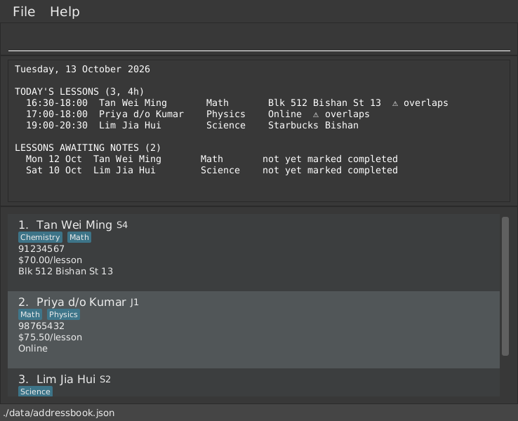

# TutorFlow User Guide

TutorFlow is a **desktop application that keeps your students and lessons in one place, optimized for use through a Command Line Interface (CLI)** while retaining the benefits of a Graphical User Interface (GUI).
For power-users, TutorFlow can help you manage your students and lessons faster than traditional GUI applications.

<!-- * Table of Contents -->
<page-nav-print />

--------------------------------------------------------------------------------------------------------------------

## Quick start

1. Ensure that Java `25` or later is installed on your computer.<br>
   **Mac users:** Ensure you have the precise JDK version prescribed [here](https://se-education.org/guides/tutorials/javaInstallationMac.html).

1. Download the latest `.jar` file from [the TutorFlow releases page](https://github.com/AY2627S1-CS2103T-F15-1/tp/releases/latest).

1. Copy the file to the folder you want to use as the _home folder_ for TutorFlow.

1. Open a terminal, `cd` to the folder containing the JAR file, and run `java -jar tutorflow.jar`.<br>
   A GUI similar to the one below should appear in a few seconds. A new data set starts empty, so your own list will have no students until you add some. The screenshot below shows a list that already contains students.<br>
   

1. Type a command in the command box and press Enter to execute it. For example, type **`help`** and press Enter to see the list of commands.<br>
   Some example commands you can try:

   * `list` : Lists all students.

   * `add n/John Doe p/98765432 l/S4 s/Math r/50` : Adds a student named `John Doe`, who is in Secondary 4, learns Math and pays $50 per hour.

   * `delete 3` : Deletes the 3rd student shown in the current list.

   * `clear confirm` : Deletes all students, lessons, homework, tasks, and financial history.

   * `exit` : Exits the app.

1. Refer to the [Features](#features) section below for details of each command.

--------------------------------------------------------------------------------------------------------------------

## Features

<box type="info" seamless>

**Notes about the command format:**<br>

* Words in `UPPER_CASE` are the parameters to be supplied by the user.<br>
  For example, in `add n/NAME`, replace `NAME` with a value such as `John Doe`.

* Items in square brackets are optional.<br>
  For example, `n/NAME [e/EMAIL]` can be used as `n/John Doe e/john@example.com` or as `n/John Doe`.

* Items followed by `...` can appear zero or more times.<br>
  For example, `s/SUBJECT...` can be written as `s/Math` or `s/Math s/Physics`.

* Items such as `week/` and `all/` are flags: write them on their own, without a value.<br>
  For example, `agenda week/` is accepted, but `agenda week/yes` is rejected.

* Parameters can be in any order.<br>
  For example, if the command specifies `n/NAME p/PHONE_NUMBER`, `p/PHONE_NUMBER n/NAME` is also acceptable.

* `list` accepts academic filters and archive flags; invalid or extra arguments are rejected.<br>
  For example, `student list l/S4 s/Math` shows active S4 Math students.

* `today` and `exit` take no parameters. If you type anything after them, TutorFlow shows an error and does not run them.<br>
  For example, `exit now` is rejected, so a mistyped command cannot close the app.

* Command words are not case-sensitive: `LIST`, `List` and `list` are the same command, and so are `LESSON ADD` and `lesson add`. The same goes for the keyword `confirm`. Parameter prefixes such as `n/` and `st/` must still be in lower case, and the values you type keep their case.

* The command box remembers the commands you have entered in this session. Press `Up` to bring back an earlier command and `Down` to move forward again, as in a terminal. Down past the newest command returns to what you were typing.<br>
  When a command fails, it stays in the command box, so you can correct it instead of typing it all again.
* While the command box contains text, a cross button appears at its right edge. Click it to clear the box and return to typing; it disappears when the box is empty.

* If you enter an unknown command, such as `foo`, TutorFlow shows `Unknown command. Type "help" for list of commands.` Type `help` to see the available commands.

* If you are using a PDF version of this document, be careful when copying and pasting commands that span multiple lines as space characters surrounding line-breaks may be omitted when copied over to the application.
</box>

### Student card shortcuts

The student cards provide shortcuts that fill the command box for you. They do not run the command or change any data; you still review or complete the command and press Enter.

* Hover over a card, or move keyboard focus into it, to reveal the edit, archive and delete buttons. On a touch screen, tap the card once to reveal them. Each button has a tooltip and is reachable by keyboard.
* Click the pencil on a card to show a pencil beside each editable field. This includes the name, level, subjects, phone number, rate, email, usual venue and remark. The subject pencil follows the last subject. Fields that the command system does not support are not shown as editable.
* Click a field's pencil to fill the command box with that field's command, such as `edit 1 n/` or `edit 1 s/`. Type the new value after the prefix and press Enter. Selecting another field replaces the prepared command. For subjects, the existing `edit` command replaces the whole subject list, so add every subject you want to keep.
* The archive and delete buttons fill in `archive INDEX` and `delete INDEX` for that card. Archiving and deletion keep their normal confirmation behaviour, so nothing happens until you submit the command.
* While editing fields, `Cancel` appears beside the card's top-right pencil. Click it to leave field-editing mode; it then disappears with the field pencils. It clears the prepared command only if you have not changed it and another shortcut has not replaced it. A command you typed yourself is left alone.
* The plus button beside the command box starts an add command with `add n/` and puts the cursor there. Complete the remaining required prefixes and press Enter.
* Each shortcut also prints the matching help command, such as `help edit` or `help archive`, to standard output. Run that command in TutorFlow to read the full usage.

The number in a prepared command is the number shown on the card in the current list. Commands use the same numbering as every other indexed command, so run `list`, `list archived/` or a search first when you need to choose the numbering. If the displayed list changes, TutorFlow clears an unchanged prepared command and closes field-editing mode so that an old number is not submitted by mistake. Text you changed yourself is never overwritten.

### Writing dates

Every date parameter, such as `d/` in `lesson add`, `agenda` and `pay`, `due/` in `hw add` and `task add`, accepts the same ways of writing a date, so you can type the one you find quickest.

* The **day, month and year** are separated by `/`, `-`, `.` or a space, the same one between all three.
* The date is written **day first** or **year first**. A month is never written first, so `12/22/2026` is not accepted.
* The **month** is a number, such as `9` or `09`, or its English name in full or short, such as `Sep`, `Sept` or `September`, in any letter case.
* The **year** has four digits, or two digits for a year from 2000 to 2099. A two-digit year is read last when that makes a real date, or first when it does not.
* `today` and `tmr` also work wherever a date is accepted, in any letter case.
* A date that does not exist, such as `30/02/2026`, is rejected. It is never moved to a nearby date.

| You can write | Meaning |
|---------------|---------|
| `2026-12-22`, `2026/12/22`, `2026.12.22`, `2026 Dec 22` | 22 December 2026, year first |
| `22/12/2026`, `22-12-2026`, `22.12.2026`, `22 December 2026` | 22 December 2026, day first |
| `22/12/26`, `22-Dec-26`, `22 Dec 26`, `22.12.26` | 22 December 2026, with a two-digit year |
| `35-12-31` | 31 December 2035, because 35 December is not a date |

<box type="warning" seamless>

**Two-digit years are read day first:** a date such as `05/10/26` is read as 5 October 2026, never as 26 October 2005. A year-first reading is used only when the day-first reading is not a real date, as in `35-12-31`, which is 31 December 2035. Write the year with four digits when you want to be certain. Every command that takes a date shows the date in full in its reply, such as `Tue 22 Dec 2026`.
</box>

### Viewing help: `help`

Shows every command, or how to use one command, without leaving TutorFlow.

Format: `help [COMMAND]`

* `help` shows every command with a one-line summary.
* `help COMMAND` shows what the command does, its parameters and an example. `COMMAND` is the command as you type it, so for the lesson commands write both words, such as `help lesson add`.
* `help lesson` lists the commands that start with `lesson`.
* `COMMAND` is not case-sensitive, like every command word, so `help LESSON ADD` works like `help lesson add`. For a name that is not a command, such as `help foo`, TutorFlow says `No help available for 'foo'. Type 'help' for the full list.`
* To read this guide inside TutorFlow, use the `Help` menu or press `F1`. The guide opens in a resizable window and works offline. Use its Contents links to jump to any feature. External links are disabled inside the offline viewer, which shows a message when you activate one. It shows the User Guide bundled with your version of the app. Click `Reload guide` to return to that bundled guide.
* The command list and `help COMMAND` are short syntax references. The full guide includes the field limits, examples and behavior rules.
* Documentation changes appear in the next build of the app. When running from source, restart with `./gradlew run` (Windows: `.\gradlew.bat run`) to bundle the current `docs/UserGuide.md`. For a JAR, rebuild with `./gradlew shadowJar` or download an updated release, then restart with that JAR. `Reload guide` does not download newer documentation into an older JAR.

Examples:
* `help` lists all commands.
* `help lesson move` shows how to reschedule a lesson.

### Adding a student: `add`

Adds a student to TutorFlow.

Format: `add n/NAME p/PHONE_NUMBER l/LEVEL s/SUBJECT... r/RATE [e/EMAIL] [v/VENUE]`

* `NAME` is 1-100 printable characters after trimming and must contain at least one letter. It may contain letters in any language (such as `José Álvarez` or `陈伟明`), digits, spaces and `. , ' ( ) / - @`, such as `Tan Wei Ming (twin A)`, `Priya d/o Kumar` or `John @ Tan`. It does not matter how an accent is typed, so `José` written with one character and with a letter and a separate accent is the same name. Avoid typing a `/` right after a space when it would look like a prefix, such as `s/o`, because TutorFlow reads it as the start of the next parameter.
* `LEVEL` is one of `P1` to `P6` (primary), `S1` to `S5` (secondary) or `J1` to `J2` (junior college). It is not case-sensitive, so `s3` is the same as `S3`.
* `PHONE_NUMBER` has 8 to 15 digits and can start with `+`, for example `91234567` or `+6591234567`. Spaces and hyphens between the digits are allowed and are removed, so `9123 4567` is stored as `91234567`.
* `SUBJECT` is free text of up to 30 letters in any language, digits, spaces, `&` and `-`, such as `Math`, `English & Literature` or `华文`. Subjects are not case-sensitive. When you enter one, its first letter is capitalized automatically, so `math` is saved and shown as `Math`. The rest of what you type keeps its case.
* `RATE` is the amount charged per hour in SGD, from `0` to `9999.99` with at most 2 decimal places. A leading `$` is accepted, so `50`, `50.00` and `$50` are the same rate.
* `VENUE` is where the student is usually taught, up to 100 characters.
* Extra spaces in a `NAME` are ignored, so `John  Tan` is stored as `John Tan`.
* A student can have at most 10 different subjects, so a command with more than 10 `s/SUBJECT` values is rejected. The same limit applies when you [edit](#editing-a-student-edit) a student.
* Two students are duplicates if they have the same phone number and a name that matches when letter case and extra spaces are ignored. A duplicate is not added.
* Two different students can share a name, for example two students called `Tan Wei Ming` with different phone numbers. TutorFlow adds the student and shows a note, so that you can spot a double entry.

<box type="tip" seamless>

**Tip:** A student must have between 1 and 10 subjects. The email and the venue are optional.
</box>

Examples:
* `add n/John Doe p/98765432 l/S4 s/Math r/50`
* `add n/Betsy Crowe p/98761234 l/J1 s/Physics s/Chemistry r/62.50 e/betsycrowe@example.com v/Blk 123 Bishan St 13`

### Listing students: `list`

Shows the students in TutorFlow. Archived students are hidden unless you ask for them.

Format: `list [l/LEVEL] [s/SUBJECT] [archived/|all/]`

* With no parameters, shows every active student and replies `Listed active students.`
* `l/LEVEL` shows only the students at that level, and `s/SUBJECT` only those who take that subject. Neither is case-sensitive. With both, a student must match both. A filtered list replies with the count, such as `Listed 2 matching student(s).`
* `archived/` shows only [archived](#archiving-a-student-archive) students, and `all/` shows active and archived students together. Use at most one of them, with nothing after the `/`.
* The students are numbered again, and other commands use the new numbers.
* `student list` works the same way.

Examples:
* `list` Shows all active students.
* `list l/S3 s/Math` Shows the active S3 students who take Math.
* `list archived/` Shows only the archived students, for example before you [restore](#restoring-an-archived-student-restore) one.

### Archiving a student: `archive`

Takes a student who has stopped lessons out of the active list, while their lessons and payment history stay available.

Format: `archive INDEX`

* `INDEX` is the number in the displayed student list.
* The student no longer appears in `list`. `list archived/`, `list all/` and `find` still show them, with `(archived)` after their name on the student card, and `view` shows `Viewing: NAME (archived)`.
* Their lessons, homework, charges and payments are kept, and so are their upcoming lessons in the agenda. If they owe money, `dues` still lists them, marked `(archived)`.
* An archived student cannot be given a new lesson, weekly series or homework. TutorFlow asks you to restore them first.
* Archiving a student who is already archived gives `This student is already archived.`
* `student archive INDEX` works the same way.

Examples:
* `archive 3` Archives the 3rd student and replies, for example, `Archived: Chen Hao. Lessons and history are retained. The student list has refreshed.`

### Restoring an archived student: `restore`

Brings an archived student back to the active list.

Format: `restore INDEX`

* First show the archived students with `list archived/` or `list all/`, then use the number shown there.
* Restoring a student who is already active gives `This student is already active. Use student list archived/ before restoring.`
* `student restore INDEX` works the same way.

Examples:
* `list archived/`, then `restore 1` Restores the first archived student, for example `Restored: Amy Tan. Lessons and history are retained. The student list has refreshed.`

### Editing a student: `edit`

Edits an existing student in TutorFlow.

Format: `edit INDEX [n/NAME] [p/PHONE_NUMBER] [e/EMAIL] [l/LEVEL] [s/SUBJECT]... [r/RATE] [v/VENUE]`

* Edits the student at the specified `INDEX`. The index refers to the index number shown in the displayed student list. The index **must be a positive integer** 1, 2, 3, ...
* At least one of the optional fields must be provided.
* Existing values will be updated to the input values.
* To remove an optional email or usual venue, give an empty `e/` or `v/`, for example `edit 1 e/ v/`.
  Omitting a prefix leaves that value unchanged. Required fields cannot be cleared. Clearing contact details
  preserves the student and all linked history; existing lessons keep their recorded venues.
* When editing subjects, all of the student's existing subjects are replaced; adding subjects is not cumulative. A student must keep at least one subject.
* After changing a student's name or phone number, run `lesson list st/STUDENT_INDEX` again before using lesson numbers.
* The values for the level, subjects, rate and venue follow the same rules as for [`add`](#adding-a-student-add).
* If the edit gives the student the name of another student, it is accepted and TutorFlow shows a note. If the phone number is also the same as that student's, the edit is rejected as a duplicate.

Examples:
*  `edit 1 p/91234567 e/johndoe@example.com` Edits the phone number and email address of the 1st student to be `91234567` and `johndoe@example.com` respectively.
*  `edit 2 l/S4 s/Math s/Chemistry` Changes the 2nd student to Secondary 4, and the subjects to `Math` and `Chemistry`.

### Locating students by name: `find`

Finds students whose names contain any of the given keywords.

Format: `find KEYWORD [MORE_KEYWORDS]`

* The search is case-insensitive; for example, `hans` matches `Hans`, and `ışık` matches `Işık`,
  using the same Unicode case equivalence as student identity. Accents remain significant.
* Keyword order does not matter; for example, `Hans Bo` matches `Bo Hans`.
* The search considers only names.
* A keyword matches any part of a name; for example, `Han` matches `Hans` and `Johan`, and `wei` matches `Tan Wei Ming`.
* A keyword can be up to 100 characters long.
* Students matching at least one keyword are returned (an `OR` search); for example, `Hans Bo` returns `Hans Gruber` and `Bo Yang`.

Examples:
* `find John` returns `john` and `John Doe`
* `find alex david` lists `Alex Yeoh` and `David Li` if those students are recorded. If only those two students match, the result says `2 student(s) listed!` and the student list shows their current details with new index numbers.

### Viewing a student's overview: `view`

Shows what you need to prepare for one student, on one screen.

Format: `view INDEX`

* Shows the student at the specified `INDEX`.
* The index refers to the index number shown in the displayed student list.
* The index **must be a positive integer** 1, 2, 3, ...
* The overview shows, in this order:
  * the student's level, subjects, rate, phone number and, if recorded, email, usual venue and remark
  * the **next lesson**: the date, time, subject and venue of the first scheduled lesson from today onwards
  * the **recent lesson notes**: the notes of the 3 most recent completed lessons, newest first
  * the **lesson history**: how many lessons are completed, cancelled and missed
  * the **balance**: what the student owes, as `OUTSTANDING $X.XX`, or the credit from paying ahead, as `IN CREDIT $X.XX`. A student who owes nothing shows `OUTSTANDING $0.00`.
  * the **outstanding homework**: assignments awaiting submission or review, with due dates and feedback
* A section with nothing to show says so, for example `No upcoming lessons.`, instead of disappearing.
* An archived student is marked after their name, as in `Viewing: Chen Hao (archived)`, so that you can tell them apart from active students when you reach them through `student list all/` or `find`.
* The command only shows information. It does not change the student list, so the indexes you use for other commands stay the same.

Examples:
* `list` followed by `view 2` shows the overview of the 2nd student.
* `find Betsy` followed by `view 1` shows the overview of the 1st student in the results of the `find` command.

### Adding a remark to a student: `remark`

Sets a free-text remark on a student, such as a preference or something to remember.

Format: `remark INDEX r/REMARK`

* Sets the remark of the student at the specified `INDEX`, which is the index number shown in the displayed student list and **must be a positive integer** 1, 2, 3, ...
* The new remark replaces the old one. Writing `r/` with nothing after it removes the remark.
* Surrounding spaces are removed and repeated spaces inside the remark are collapsed into one, as for other free text.
* A remark is shown in the student's card and in [`view`](#viewing-a-students-overview-view).

Examples:
* `remark 1 r/Prefers morning lessons` sets the remark of the 1st student.
* `remark 1 r/` removes the remark of the 1st student.

### Deleting a student: `delete`

Deletes the specified student from TutorFlow.

Format: `delete INDEX [confirm]`

* Deletes the student at the specified `INDEX`.
* The index refers to the index number shown in the displayed student list.
* The index **must be a positive integer** 1, 2, 3, ...
* A student with no lessons, no homework and no [follow-up tasks](#adding-a-follow-up-task-task-add) is deleted immediately.
* Deleting a student also deletes **all of their lessons, homework (including feedback) and follow-up tasks**. If the student has any linked records, TutorFlow does not delete anything yet. It shows the student's name, phone number, linked counts and, if there are any, a warning about upcoming lessons and commitments, and asks you to repeat the command with `confirm`.
* The keyword `confirm` can be written in any letter case, such as `CONFIRM`.
* One deletion action can be reversed with the `undo` command.

Examples:
* `list` followed by `delete 2` deletes the 2nd student, if they have no lessons or homework.
* `delete 3` on a student with 12 lessons shows a prompt; `delete 3 confirm` then deletes the student and the 12 lessons.
* `find Betsy` followed by `delete 1` deletes the 1st student in the results of the `find` command.

### Sorting students by name: `sort`

Sorts all students by name, ignoring upper and lower case.

Format: `sort [asc|desc]`

* `asc` sorts from A to Z and `desc` sorts from Z to A. If no order is given, `asc` is used.
* All students are shown after sorting, even if the list was filtered by an earlier `find` command.
* TutorFlow keeps this order. A student you add later, or whose name you change, takes their place in it, so the list stays sorted.
* The order is saved, so it is still used the next time you open the app. Until you first use `sort`, new students are added at the end of the list.

Examples:
* `sort` sorts all students from A to Z.
* `sort desc` sorts all students from Z to A.

### Scheduling a lesson: `lesson add`

Schedules a lesson for a student.

Format: `lesson add st/STUDENT_INDEX [s/SUBJECT] d/DATE t/TIME [dur/MINUTES] [v/VENUE] [past/]`

* `STUDENT_INDEX` is the index number shown in the displayed student list, and **must be a positive integer** 1, 2, 3, ...
* `DATE` is written in any of the [ways to write a date](#writing-dates), such as `2026-12-22`, `22/12/2026` or `22 Dec 26`, or as the word `today` or `tmr` (tomorrow), in any letter case, which TutorFlow works out from the date on your computer. It must be today or later, and no more than 2 years ahead, which catches a mistyped year.
* `past/` is a flag that records a lesson that has **already taken place**, so that you can complete it and bill it. With `past/`, a date before today is accepted, up to 2 years ago, but a date after today is rejected, so use `past/` only for a lesson that has already taken place. Without it, a date in the past is rejected, because that is usually a mistyped year. Every other rule still applies.
* Each lesson remembers the student's **level at the time of booking**, so that `lesson list` can still show it after the student moves up a level. Lessons that were booked before this version show `unknown (not recorded)`.
* `TIME` is written in 24-hour time, such as `16:30`. `4:30pm` and `1630` are also accepted.
* `MINUTES` is the length of the lesson, from `15` to `480` in steps of `15`. If it is left out, it is `60`.
* `SUBJECT` must be one of the student's subjects, and is not case-sensitive. If the student has only one subject, it can be left out. If the student has several, it must be given.
* `VENUE` is up to 100 characters. If it is left out, the student's usual venue is used, or `—` if the student has none.
* A lesson must end on the day it starts, so `t/23:00 dur/120` is rejected. Split it into two lessons.
* Two lessons are duplicates if they have the same student, subject, date, time and duration. A duplicate is rejected.
* Adding a lesson keeps the current day, week or student lesson filter. If the new lesson shifts existing lesson numbers, the result shows the complete current lesson list with fresh numbers. Use those numbers for your next lesson command.

<box type="warning" seamless>

**Overlaps only warn:** if the new lesson overlaps another scheduled lesson by at least one minute on the same date, it is still scheduled and the result lists the lessons it overlaps with. Lessons that end exactly when the next one starts do not overlap. Cancelled lessons are ignored.
</box>

Examples:
* `lesson add st/1 s/Math d/2026-12-22 t/16:30 dur/90` Schedules a 90-minute Math lesson for the 1st student at the student's usual venue.
* `lesson add st/2 d/2026-12-23 t/19:00 v/Online` Schedules a 60-minute lesson online for the 2nd student, in the only subject that student takes.
* `lesson add st/2 d/tmr t/19:00 dur/60 v/Online` Schedules a lesson for tomorrow.
* `lesson add st/1 d/2026-10-12 t/16:30 past/` Records a lesson on 12 October 2026 that has already happened, even though that date is past.

### Scheduling a weekly series: `lesson repeat`

Schedules the regular weekly lessons of a student in one command.

Format: `lesson repeat st/STUDENT_INDEX [s/SUBJECT] d/START_DATE t/TIME [dur/MINUTES] [v/VENUE] count/COUNT [every/WEEKS]`

* The student, subject, date, time, duration and venue are written as for [`lesson add`](#scheduling-a-lesson-lesson-add), except that `past/` is **not** accepted: a series starts today or later.
* A series cannot be scheduled for an **archived student**: restore the student first with `restore INDEX`, as for `lesson add`.
* `COUNT` is the number of lessons, from `2` to `52`. `WEEKS` is the gap between two lessons in weeks, from `1` to `12`; if `every/` is left out, it is `1`. Every lesson must fall within 2 years of today.
* The first lesson is on `START_DATE`. Each later lesson is at the same time of day, `WEEKS` weeks after the one before it.
* The series is **all or nothing**. TutorFlow checks every lesson first, and if any of them is invalid or is a duplicate of a lesson that already exists, it adds none of them and says `This exact lesson already exists. No occurrences were added.`
* Each lesson is a full, independent lesson: you can move, cancel, complete or bill it on its own. The lessons are linked only so that a series can be cancelled together.
* The new lessons are not added to the lesson list that is displayed, so run `agenda` or `lesson list st/STUDENT_INDEX` to see and number them. If adding the series changes the numbers on screen, the result ends with `Lesson numbers have changed. Current lesson list:` and the new numbering, as `lesson add` does.
* Lessons that overlap another lesson only produce a warning, as for `lesson add`. If many lessons of the series overlap, the warning is summarised in one line.

Examples:
* `lesson repeat st/4 d/2026-10-29 t/16:00 count/4` Schedules four weekly lessons, starting on 29 October 2026.
* `lesson repeat st/1 d/tmr t/17:00 dur/90 count/10 every/2` Schedules ten lessons two weeks apart, starting tomorrow. The result says `Scheduled 10 occurrences, every 2 weeks.`

### Viewing the agenda: `agenda`

Shows the lessons of a day or of a week, in the order that they take place.

Format: `agenda [d/DATE] [week/]`

* Without `d/DATE`, it shows today. `DATE` is written as for [`lesson add`](#scheduling-a-lesson-lesson-add).
* With `week/`, it shows the Monday to Sunday week that contains the date, one day after another. A day without lessons shows `— no lessons —`.
* Each line shows the lesson number, the time, the student, the subject, the venue, and the status if the lesson is not simply scheduled. Lessons that overlap another lesson are marked `⚠ overlaps`.
* Cancelled lessons are listed but are not counted in the number of lessons and the total time.
* The lesson numbers are the ones that `lesson move`, `lesson cancel`, `lesson done` and `lesson missed` take, so run `agenda` or `lesson list` first and then use the number you see.
* Lessons are numbered in time order. If moving, cancelling, completing or marking a lesson missed changes the displayed numbers, the result includes `Lesson numbers have changed. Current lesson list:` and the refreshed list. If every lesson keeps its number, for example when a lesson only changes its time or is cancelled but stays in the list, the numbers are not shown again. Use those new numbers for your next command. Running `agenda` or `lesson list` again also refreshes the list.
* A week with more than 200 lessons shows the first 200 rows and a line saying how many were omitted, so the result box stays responsive.
* A day without lessons is not an error: it shows `No lessons on Tue 22 Dec 2026.`

Examples:
* `agenda` Shows today's lessons.
* `agenda d/2026-12-22 week/` Shows the week of Monday 21 December 2026.

### Viewing today's dashboard: `today`

Shows what today requires: today's lessons, past lessons not yet marked completed, overdue homework, and the students who owe money. TutorFlow also shows this when it starts.

Format: `today`

* The first section, `TODAY'S LESSONS`, shows the number of lessons today and their total time, followed by the time, student, subject and venue of each lesson. Lessons that overlap another lesson are marked `⚠ overlaps`. Cancelled lessons are left out.
* The second section, `LESSONS AWAITING NOTES`, shows the scheduled lessons from earlier days that were not marked completed, the most recent first.
* The third section, `OVERDUE HOMEWORK`, shows assigned work due before today, or `No overdue homework.`. Run `hw list overdue/` to get selectable numbers.
* The fourth section, `DUES`, is the list that [`dues`](#viewing-all-outstanding-balances-dues) shows: how many students owe money and the total, then each student's amount and the age of their oldest unpaid charge, such as `oldest unpaid 2 days` or `oldest unpaid 1 day`, the oldest first. If nobody owes money, it shows `No outstanding balances. Everyone is up to date.`
* All four sections are always shown. An empty section is not an error: it shows `No lessons today.`, `All past lessons are recorded.`, `No overdue homework.` or `No outstanding balances. Everyone is up to date.`
* To keep the result box responsive, each lesson section lists at most 200 rows. The heading still gives the complete count and total time.
* Today is the date on your computer, so a wrong system clock shows the wrong day.

Examples:
* `today` on Thursday 17 September 2026 might show:
  ```
  Thursday, 17 September 2026

  TODAY'S LESSONS (2, 2h 30m)
    16:30-18:00  Tan Wei Ming       Math       Blk 512 Bishan St 13  ⚠ overlaps
    17:00-18:00  Priya s/o Kumar    Physics    Online  ⚠ overlaps

  LESSONS AWAITING NOTES (1)
    Tue 15 Sep  Lim Jia Hui        Science    not yet marked completed

  OVERDUE HOMEWORK (1)
    Priya s/o Kumar Trigonometry worksheet due 2026-09-15 OVERDUE

  DUES
  1 student(s) with outstanding balances — $25.00 total
    Tan Wei Ming $25.00 oldest unpaid 2 days
  ```

### Listing the lessons of a student: `lesson list`

Shows the lessons of one student.

Format: `lesson list st/STUDENT_INDEX [all/]`

* `STUDENT_INDEX` is the index number shown in the displayed student list.
* By default, only upcoming lessons are shown, which means scheduled lessons from today onwards. With `all/`, past, completed, cancelled and missed lessons are shown as well.
* Each line ends with the student's level when the lesson was booked, such as `[Level at booking: S3]`, and the status. A lesson that was booked before this was recorded shows `[Level at booking: unknown (not recorded)]`.
* The lessons are numbered in date order. These are the numbers that `lesson move`, `lesson cancel`, `lesson done` and `lesson missed` take.

Examples:
* `lesson list st/1` Shows the upcoming lessons of the 1st student.
* `lesson list st/1 all/` Shows every lesson of the 1st student.

### Rescheduling a lesson: `lesson move`

Moves a lesson to another date, time, duration or venue, and keeps everything else.

Format: `lesson move INDEX [d/DATE] [t/TIME] [dur/MINUTES] [v/VENUE]`

* `INDEX` is the lesson number in the list that is currently shown by `agenda` or `lesson list`, and **must be a positive integer** 1, 2, 3, ...
* At least one of the optional fields must be given. Fields that are not given stay as they were.
* The values follow the same rules as for [`lesson add`](#scheduling-a-lesson-lesson-add). A new date must be today or later. Only a date that you give is checked, so you can still change the time of a lesson that has already passed.
* A completed, cancelled or missed lesson cannot be rescheduled. Moving a missed lesson would lose the record that it was missed, so schedule a make-up lesson with [`lesson add`](#scheduling-a-lesson-lesson-add) instead.
* If the move makes the lesson identical to another lesson, it is rejected. If it makes the lesson overlap another lesson, it is moved and the result warns you.

Examples:
* `lesson move 1 d/2026-12-24` Moves the 1st lesson to 24 December 2026 at the same time.
* `lesson move 2 t/17:00 v/Online` Moves the 2nd lesson to 17:00 and changes its venue to `Online`.

### Cancelling a lesson: `lesson cancel`

Cancels a lesson but keeps its record, so that you can still see that the slot was booked.

Format: `lesson cancel INDEX [r/REASON]`

* `INDEX` is the lesson number in the list that is currently shown by `agenda` or `lesson list`.
* `REASON` is up to 200 characters on one line, such as `Student unwell`.
* The lesson stays in the agenda as cancelled and no longer overlaps other lessons.
* A lesson that is already cancelled or already completed cannot be cancelled.
* A cancelled lesson does not block its slot. To book that time again, use `lesson add` with the same details. The cancelled record stays in your history.
* A lesson that was marked missed can still be cancelled, for example to correct a booking that should never have counted. Its date, time, venue and notes are kept.
* A missed lesson with an active charge cannot be cancelled. Reverse the charge first with [`charge reverse`](#charging-a-lesson-charge).

<box type="warning" seamless>

**Cancelling a missed lesson replaces its missed record:** the lesson then counts as cancelled, not missed, in `view` and `lesson list`, and this cannot be undone. Only cancel a missed lesson if the "missed" was a mistake.
</box>

Examples:
* `lesson cancel 1` Cancels the 1st lesson.
* `lesson cancel 3 r/Student unwell` Cancels the 3rd lesson and records the reason.

### Cancelling future occurrences of a series: `lesson series cancel`

Ends a recurring series without erasing its history.

Format: `lesson series cancel LESSON_INDEX confirm`

* Select the displayed number of any occurrence belonging to the series, even a past occurrence.
* `confirm` is required, and can be written in any letter case. Without it, no lesson is changed.
* All scheduled occurrences starting now or later are cancelled together, including occurrences moved to another date or time. Occurrences that have started, or are already completed, missed or cancelled, remain unchanged.
* Each affected lesson keeps its identity and booking details, with the reason `Series cancelled`. No record is deleted.
* A lesson not linked to a recurring series is rejected. A series with no eligible occurrences is also rejected without changing data.
* Select an existing occurrence of the series. This command cancels existing recurring bookings; it does not create them.
* If any affected occurrence has a recorded charge, nothing is cancelled. Billed history is retained.
* Cancellation is a status change, not a deletion, and is not undoable. `confirm` is required because the change affects multiple bookings.
* Success is `Cancelled N series occurrences.` (or `Cancelled 1 series occurrence.` for a single occurrence).

Example: `lesson list st/1 all/`, then `lesson series cancel 3 confirm` cancels the eligible occurrences of the series containing the 3rd displayed lesson.

### Setting travel warnings: `travel`

Sets one offline buffer for journeys between lessons at different physical venues. Warnings never block a booking and do not calculate routes or actual journey times.

Format: `travel buffer/MINUTES`

* `MINUTES` must be a whole number from 0 to 180, inclusive. The default is 30 minutes; 0 disables travel warnings. The setting is saved and restored on reopening TutorFlow. Any other value, such as `buffer/200`, shows the command usage and changes nothing.
* Each scheduled lesson is compared with earlier scheduled lessons on the same date. The gap starts when the **latest-ending** earlier lesson ends, not necessarily the lesson that started most recently.
* A gap shorter than the buffer produces a warning naming both students, the venues, destination date and time, available minutes and required buffer. For example: `Travel warning: Tan Wei Ming at Bishan -> Priya Kumar at Clementi (Sat 24 Oct 2026 11:10): 10 min available; 30 min required.` Back-to-back lessons at different venues have a zero-minute gap and can therefore trigger a travel warning without overlapping.
* There is no travel warning for overlapping lessons, an unnamed venue, `Online` (ignoring case), or the same venue ignoring case. If several preceding lessons finish together, the first at a different physical venue is used.
* After `lesson add`, `lesson repeat` and `lesson move`, warnings cover journeys into or out of the added or moved lessons, not unrelated journeys on those dates. Warnings also appear below each day's relevant lessons in `agenda` and below today's lessons in `today`, and when you change the buffer, which lists the warnings on every date, including past ones. Changing the buffer does not change the currently displayed lesson numbers.
* To keep command results responsive, a single result shows at most 50 travel warnings. If more exist, the result says how many were shown and how many exist in total. The rest remain in the data and are shown by narrower agenda or lesson queries.

Examples:

* `travel buffer/10` sets a ten-minute buffer and reports insufficient gaps.
* `travel buffer/0` disables travel warnings; overlap warnings still work.

### Completing a lesson and recording notes: `lesson done`

Marks a lesson completed and optionally records what was taught.

Format: `lesson done INDEX [n/NOTES]`

* `INDEX` is the lesson number from the current `agenda` or `lesson list`, not the student number. It must be a positive integer.
* The first completion adds the hourly lesson fee to the student’s balance and shows `Charge of $X.XX recorded.` Updating notes never charges again. A fee that is zero, including after cent rounding, completes the lesson without creating a charge and explains why: for a rate of $0.00 it says `No automatic charge: This student's rate is $0.00.` and how to specify an amount. Use [`charge`](#charging-a-lesson-charge) to bill a lesson by hand.
* Only lessons dated today or earlier can be completed, using your computer's local date. A cancelled lesson cannot be completed.
* `NOTES` is optional free text of 1–1000 printable characters on one line. Leading/trailing whitespace is trimmed and repeated spaces are collapsed. An empty `n/`, line breaks and repeated `n/` parameters are rejected.
* Completing a lesson retains its student, subject, date, time, duration and venue. The status and notes are saved automatically. Use `view STUDENT_INDEX` to see recent notes and the completed-lesson count.
* Repeating the command with `n/NOTES` updates the notes on the same completed lesson. Omitting `n/` retains existing notes. A lesson previously marked missed can also be changed to completed.
* A completed lesson disappears from an upcoming-only `lesson list`. Use `lesson list st/STUDENT_INDEX all/` to include it again; check the current lesson number before updating notes.
* A space followed by `n/` starts a note parameter, so it cannot also appear literally inside the note text.

Examples:
* `agenda` followed by `lesson done 1` completes today's 1st lesson without adding notes.
* `lesson list st/1 all/` followed by `lesson done 2 n/Covered quadratic roots. Revise factorisation.` completes the 2nd displayed lesson or updates its notes if already completed.

### Recording a missed lesson: `lesson missed`

Marks a scheduled lesson as missed without deleting its record.

Format: `lesson missed INDEX`

* `INDEX` is the positive lesson number from the current `agenda` or `lesson list`, not the student number. Use `lesson list st/STUDENT_INDEX all/` to select a past lesson.
* Only lessons dated today or earlier can be marked missed, using your computer's local date. Future, cancelled and completed lessons are rejected without changing data.
* The student, subject, date, time, duration, venue and existing notes are retained. The missed status is saved automatically and counted in `view STUDENT_INDEX` under lesson history.
* A missed lesson disappears from an upcoming-only list and no longer counts as a scheduling overlap. Use `all/` to include it again and check its current lesson number.
* Repeating `lesson missed` on the same missed lesson leaves it unchanged. If the lesson actually took place, use `lesson done INDEX [n/NOTES]` to correct it to completed.
* No extra parameters are accepted. This command does not record fees or payments.

Examples:
* `agenda` followed by `lesson missed 1` marks today's 1st displayed lesson as missed.
* `lesson list st/1 all/` followed by `lesson missed 2` marks the 2nd displayed lesson as missed, provided it is scheduled for today or earlier.

### Adding a follow-up task: `task add`

Keeps a to-do attached to the student, lesson, homework item or payment that it is about, so that you do not forget it.

Format: `task add st/INDEX|lesson/INDEX|hw/INDEX|pay/INDEX desc/TEXT [due/DATE]`

* Give **exactly one** link. `st/INDEX` takes a number from the displayed student list. `lesson/INDEX` takes a lesson number from the last `agenda` or `lesson list`.
* `hw/INDEX` takes a homework number from the last `hw list`. `pay/INDEX` takes a payment number from the last `pay list`. If no payment list has been shown, or `INDEX` is out of range, TutorFlow answers `Invalid payment index. Run 'pay list' first.` If the selected homework or payment was deleted since, TutorFlow says so instead of picking another item; for a payment, the message is `That payment was deleted. Run 'pay list' to refresh.`
* `TEXT` is 1 to 200 characters on one line.
* `DATE` is written as for [`lesson add`](#scheduling-a-lesson-lesson-add). It is optional, and a task without one is shown as `(no due date)`. A due date must be today or later (`today` and `tmr` work), otherwise TutorFlow answers `Due dates must be today or later.`
* Two tasks may have the same text. That is not a duplicate.
* A task is linked to its student, lesson, homework or payment by their permanent identifiers, not by name, phone, time or amount. Editing a student, moving, cancelling or rebooking a lesson, editing homework, or reversing a payment never changes what a task is about, and a new booking in the slot of a cancelled lesson does not take over that lesson's tasks. When a student, a lesson or a homework item is deleted, the tasks about it are deleted with it.

Examples:
* `task add st/1 desc/Call parent due/2026-12-01` adds a task to the 1st student, due on 1 December 2026.
* `task add lesson/1 desc/Prepare mock paper` adds a task to the 1st lesson in the current agenda.
* `task add pay/1 desc/Remind about fees` adds a task to the 1st payment in the last `pay list`.

### Listing tasks: `task list`

Shows the tasks that still have to be done.

Format: `task list [all/] [st/INDEX]`

* By default, only open tasks are shown, with the earliest due date first and the tasks without a due date last. With `all/`, completed tasks are shown as well.
* `st/INDEX` limits the list to the tasks of one student, including the tasks about that student's lessons.
* Each row shows the status, the text, the due date, the student, and what the task is about: the student, or the linked lesson, homework item or payment as it now reads.
* The task numbers stay **fixed until the next `task list`**: completing or deleting a task does not renumber the others.

Examples:
* `task list` shows the open tasks.
* `task list all/ st/2` shows every task, open or done, of the 2nd student.

### Editing a task: `task edit`

Changes the text, and optionally the due date, of a task.

Format: `task edit INDEX desc/TEXT [due/DATE|due/-]`

* `INDEX` is the task number from the last `task list`.
* `desc/` is always needed. Leave out `due/` to keep the due date, give a date (today or later) to change it, or write `due/-` to remove it.
* Whether a task is done, and what it is about, do not change.

Examples:
* `task edit 1 desc/Call parent again due/-` changes the text of task 1 and removes its due date.

### Completing a task: `task done`

Marks a task as done. It stays in the history, which `task list all/` shows.

Format: `task done INDEX`

* `INDEX` is the task number from the last `task list`. A task that is already done answers `That task is already done.`

Examples:
* `task done 1`

### Deleting a task: `task delete`

Deletes a task for good.

Format: `task delete INDEX [confirm]`

* `INDEX` is the task number from the last `task list`.
* Without `confirm`, TutorFlow only asks you to repeat the command with `confirm` and deletes nothing.
* If the task was already deleted, TutorFlow says `That task was deleted. Run 'task list' to refresh.`

Examples:
* `task delete 1` asks for confirmation, and `task delete 1 confirm` then deletes task 1.

### Recording a payment: `pay`

Records money received from a student and shows the updated outstanding balance or credit.

Format: `pay st/STUDENT_INDEX amt/AMOUNT [d/DATE] [n/NOTES]`

* `STUDENT_INDEX` is the positive student number in the displayed student list. After `find`, use that filtered list's numbers. It is independent of lesson numbers, so payment can follow `lesson done` immediately without running `agenda` or `list` again.
* `AMOUNT` must be greater than zero with at most two decimal places, such as `50`, `50.00` or `0.50`. Dollar signs, negative amounts, zero, commas and scientific notation are rejected.
* A payment of $10,000.00 or more is recorded, but TutorFlow adds a warning such as `Warning: $100000.00 is an unusually large payment. Check that the amount has no extra digits.`
* `DATE` defaults to today using your computer's local date. Accepts `YYYY-MM-DD`, `DD/MM/YYYY`, `today` and `tmr`; future dates are rejected with `Payment dates cannot be in the future.`
* `NOTES` is optional printable text of 1–200 characters on one line, such as a transfer reference. Extra spaces are collapsed and the notes are saved with the payment.
* Each prefix can appear once, in any order. Both `st/` and `amt/` are required. Empty or repeated fields are rejected.
* Payments are saved automatically. Partial payments reduce the amount owed; excess payments and advance payments are accepted as credit. Archived students can receive payments.
* Every invocation records another payment. If saving fails after a payment is applied, fix the save problem and use `save` to retry; repeating `pay` would record a second payment.
* After each payment, TutorFlow reminds you that payment numbers stay as last shown. To correct a wrong payment, see [`pay list` and `pay reverse`](#listing-and-reversing-payments-pay-list-pay-reverse). A lesson charge is corrected with [`charge reverse`](#charging-a-lesson-charge).

Examples:
* `pay st/1 amt/20` records $20 received from the first displayed student today.
* `pay st/2 amt/50.25 d/2026-10-18 n/PayNow ref 4471` records an earlier payment with a reference.

Example output:
```text
Payment of $20.00 recorded for Alice on 2026-10-19.
Balance: OUTSTANDING $30.00.
Payment indices stay as last shown; run 'pay list' to refresh.
```

### Listing and reversing payments: `pay list`, `pay reverse`

Shows the payments you have recorded, and takes back a payment that was entered wrongly.

Format: `pay list [st/STUDENT_INDEX]`

Format to take a payment back: `pay reverse PAYMENT_INDEX`

* `pay list` shows every payment, oldest first, or only those of one student when you give `st/STUDENT_INDEX` (a number from the displayed student list). Each row has a number, the date, the student, the amount and any notes. A payment that was reversed stays in the list, marked `[REVERSED]`.
* `pay list` displays the first 200 rows and then `Showing 200 of N payments`. Hidden rows keep their numbers, so `pay reverse INDEX` can still address them.
* `PAYMENT_INDEX` is the number from the **last** `pay list`. The numbers stay fixed until you run `pay list` again, even after you add or reverse payments, so a number always means the row you saw.
* A payment can be reversed once, and a reversal cannot itself be reversed. If you reversed a payment by mistake, record the payment again with `pay`.
* The original payment is kept and an opposite entry is added, so the account shows both the mistake and its correction. Reversing a payment that has already been counted against charges is allowed; the balance is recalculated.
* If no list has been shown, or the number is not in it, TutorFlow says `Invalid payment index. Run 'pay list' to display payments first.` Reversing a payment twice says `That payment has already been reversed.`

Examples:
* `pay list` lists all payments.
* `pay list st/2` lists the payments of the second displayed student.
* `pay reverse 2` reverses payment 2 of the last list.

Example output. `pay reverse 2` replies:
```text
Payment of $50.00 reversed.
```
and a later `pay list` shows that payment marked:
```text
PAYMENTS
1. 2026-10-18 Priya Kumar $100.00 — PayNow ref 4471
2. 2026-10-19 Priya Kumar $50.00 [REVERSED]
Use 'pay reverse INDEX' with these rows. Indices stay fixed until the next 'pay list'.
```

### Charging a lesson: `charge`

Records what a lesson cost by hand, or takes a charge back. TutorFlow normally charges a lesson by itself when you complete it with `lesson done`. `charge` is for the cases that does not cover: billing a missed lesson, an agreed discount, or a lesson of a student whose rate is $0.

Format: `charge l/LESSON_INDEX [amt/AMOUNT]`

Format to take a charge back: `charge reverse l/LESSON_INDEX`

* `LESSON_INDEX` is the lesson number from the current `agenda` or `lesson list`, not the student number.
* Without `amt/`, the charge is the student's current hourly rate × the lesson duration ÷ 60, rounded to cents. `AMOUNT` must be greater than zero with at most two decimal places.
* Only a completed or missed lesson can be charged. A cancelled lesson gives `Cannot charge a cancelled lesson.`, and a lesson that is still scheduled gives `Cannot charge a lesson scheduled for Thu 22 Oct 2026.`
* A lesson has at most one active charge. A second one gives `That lesson already has a charge of $75.50.`
* If the student's rate is $0 and you give no `amt/`, TutorFlow asks you to specify an amount.
* A charge is never deleted. `charge reverse` adds an opposite entry dated today, so the account shows both the charge and its correction. After a reversal the lesson can be charged again, for example with a different amount. If the student has already paid, the reversal can leave them in credit.
* While a lesson has an active charge it cannot be moved or cancelled. TutorFlow says `Reverse the active charge with 'charge reverse l/INDEX' before cancelling or rescheduling this lesson.`
* A missed lesson that you billed with `charge` can still be completed with `lesson done` to correct a wrong "missed". It becomes completed and is not charged a second time.
* `charge reverse` on a lesson without an active charge gives `That lesson has no active charge; it may already have been reversed.`

Examples:
* `charge l/1` charges lesson 1 at the student's rate.
* `charge l/1 amt/50` charges $50 for lesson 1.
* `charge reverse l/1` takes back the charge of lesson 1.

Example output:
```text
Charge of $75.50 recorded for Priya Kumar — Math, Sun 18 Oct 2026.
Charge of $75.50 reversed for Priya Kumar.
```

### Viewing a student's balance: `balance`

Shows a student's account: every charge and payment in date order with a running balance, and the total owed or in credit.

Format: `balance st/INDEX`

* `INDEX` is the positive student number in the displayed student list. After `find`, it refers to that filtered list.
* Charges increase the balance and payments reduce it. A withdrawal also reduces available credit and is shown as `withdrawal -$X.XX`. A reversal (see `charge reverse` and `pay reverse`) is shown as its own row, `reversal of charge (DATE) $X.XX` or `reversal of payment (DATE) $X.XX` with the date of the entry it cancels, and is taken out of the totals. Events on the same day keep the order in which they were recorded. The last line gives the total charged, the total paid, the total withdrawn and the balance. Debt is shown as `OUTSTANDING $X.XX`; an overpayment is shown as `IN CREDIT $X.XX`, and a running balance that has gone into credit is shown the same way instead of as a negative number.
* A student with no charges or payments shows `No charges or payments recorded for NAME.`
* The first time a lesson is completed with `lesson done`, TutorFlow records the student's current hourly rate × the lesson duration in minutes ÷ 60, rounded to cents using HALF_UP, as one charge. For example, $60/hour for 90 minutes costs $90.00. Updating the notes later does not charge again. Changing the student's rate does not change earlier charges.
* Scheduled, cancelled and missed lessons do not create charges. A missed lesson creates a charge only if subsequently completed.
* Existing completed lessons in older data files are not charged retroactively. Accounts start with no financial records when the file has no ledger.
* Charges and payments use permanent student identifiers, so editing the student’s name or phone retains their balance.
* Charges, payments and withdrawals are saved with the rest of the data. Use `pay st/INDEX amt/AMOUNT` to record money received, and `withdraw` to return available credit.

Example: `balance st/1` shows the account of the first displayed student:
```text
Account — Lee Bob
2026-10-17 charge Chemistry lesson $90.00 bal $90.00
2026-10-19 payment -$50.00 bal $40.00
Total charged $90.00 · total paid $50.00 (after reversals) · total withdrawn $0.00 · OUTSTANDING $40.00
```

### Withdrawing available credit: `withdraw`

Returns credit from a student's account, for example after an overpayment. A withdrawal is kept as its own history entry; it never deletes or edits the original payment.

Format: `withdraw st/STUDENT_INDEX amt/AMOUNT [d/DATE] [n/NOTES]`

* `STUDENT_INDEX` is the positive student number in the displayed student list. Archived students with credit can be selected from `list archived/`.
* `AMOUNT` must be greater than zero with at most two decimal places, and cannot exceed the student's available credit. Withdrawing the full credit is allowed.
* A student who owes money, or has no credit, gets an error and no withdrawal is recorded.
* `DATE` defaults to today and cannot be in the future. `NOTES` is optional printable text of 1-200 characters on one line.
* A withdrawal is saved automatically. It appears on the account statement as `withdrawal -$X.XX` and reduces the available credit.

Examples:
* `withdraw st/1 amt/20` returns $20 of credit to the first displayed student today.
* `withdraw st/2 amt/50.25 d/2026-10-18 n/Bank transfer` records an earlier withdrawal with a reference.

### Viewing all outstanding balances: `dues`

Lists every student with a positive balance, ordered by their oldest unpaid charge first, with a total amount owed.

Format: `dues`

* Includes students hidden by `find`; the current student list and its indices are unchanged.
* Shows `DUES`, the number of students and total owed, then each student’s amount and `oldest unpaid N days` (`1 day` for a single day). Archived students are included and marked `(archived)`.
* Payments cover the oldest charges first; a partly paid charge remains the oldest unpaid charge until fully covered. Students with the same oldest unpaid date are ordered by name and then phone number.
* Zero balances and credit balances are omitted. One student's credit does not reduce another student's debt or the total outstanding.
* Takes no parameters. If nobody owes money, shows `No outstanding balances. Everyone is up to date.`

### Clearing all entries: `clear`

Deletes **all** students, lessons, homework, tasks, and financial history (charges and payments) from TutorFlow.

Format: `clear confirm`

* Typing `clear` on its own deletes nothing. It only reminds you what would be deleted and how to confirm.
* `confirm` can be written in any letter case. Anything else after `clear` is rejected, so a mistyped command can never wipe your data.
* TutorFlow saves the empty data straight away. An `undo` immediately after the clear can restore it in this session, but it is still wise to keep a backup.
* Clearing data that is already empty works and does nothing.
* If you clear data and make no other change, `undo` restores it. Closing TutorFlow or making another change removes that undo opportunity.

Examples:
* `clear` shows `This deletes ALL students, lessons, homework, tasks, and financial history. Type 'clear confirm' to proceed.`
* `clear confirm` deletes everything.

### Undoing your latest deletion or clear: `undo`

Reverses the latest deletion or clear made in this session.

Format: `undo`

* It applies to `delete`, `hw delete`, `task delete` and `clear confirm`; it does not restore lesson cancellations or other edits.
* It undoes one destructive action, in the current session only. Undoing one action uses up the available undo point.
* Any later successful change clears the undo opportunity: adding, editing or sorting leaves nothing to undo, while another deletion replaces it with a new undo point. Read-only commands such as `list` and `view` do not.
* If the restoration cannot be saved, the restored data stays in memory and `save` can retry the write.

Examples:
* `undo` with no eligible action shows `Nothing to undo. Undo restores your latest deletion or clear, and only until you make another change.`
* `delete 2 confirm` followed by `undo` shows `Undone: student deletion. Your data is back as it was before.`, reversing the delete.

### Exiting the program: `exit`

Exits the program.

Format: `exit`

### Saving the data

TutorFlow automatically saves after a command changes data. If saving fails, fix the reported problem and use `save` to retry before closing. Read-only commands do not write the data file.

Each save is written completely to a temporary file beside the data file before replacing the previous save. If writing fails, the previous saved contents remain intact. If your file system cannot replace files atomically, TutorFlow reports a save error; move the app to a local folder that supports atomic file replacement and retry.

If a change cannot be saved, for example because the disk is full or the file is read-only, TutorFlow says `Your change was applied in this session but could not be saved`, and the reason. The change is still in the running app, so fix the problem (free some space, or make the file writable) and run `save` to retry saving. Read-only commands do not write the data file. Closing TutorFlow with `exit`, the window close button, or File > Exit retries saving and is refused if saving still fails, so that you do not lose the change.

Read-only commands do not routinely save. After a failed save, they display an unsaved-changes reminder. Run `save` after fixing the problem; a successful retry clears that reminder.

Only open one instance for a data file: concurrent instances use last-write-wins and can overwrite each other's changes.

Names, venues, reasons and notes must be printable text on one line; repeated spaces are collapsed. Email local parts may include `%`, the terminal domain label must contain at least two letters, and comparison ignores case.

Previously accepted names, short phone numbers, email terminal labels and venues remain readable through explicit legacy loading. Invalid subject counts (outside 1-10 distinct subjects) and invalid cancellation reasons reject the whole data file and use the recovery process below; individual records are never silently discarded.

### Editing the data file

TutorFlow data is saved automatically as a JSON file `data/tutorflow-v14.json` relative to the folder from which TutorFlow is launched. Advanced users are welcome to update data directly by editing that data file.

Every lesson and homework assignment must link to a student in the same file through its internal student ID. Legacy lessons are linked by name and phone during migration. Missing student links are treated as invalid, as described below.

<box type="warning" seamless>

**Caution:**
If your changes make the data file invalid, TutorFlow does not delete it. At the next run it renames the file to `tutorflow-v14.json.corrupt` (or `tutorflow-v14.json.corrupt.1` and so on, if that name is taken), starts with no students and lessons, and tells you where the file went. Fix the file and rename it back to `tutorflow-v14.json` while TutorFlow is closed to get your records back. We still recommend backing up the file before editing it.<br>
If the original cannot be renamed (for example, while another program holds it open), saving is blocked and retries preservation before replacing it. The original bytes are retained in the `.corrupt` copy once the lock clears.<br>
If TutorFlow cannot **open** the data file, for example because another program holds it open or you may not read it, the file can well be valid, so TutorFlow never renames it. It does not start: a window says why, nothing is changed, and nothing is saved over the file. Fix the problem and start TutorFlow again.

Furthermore, certain edits can cause TutorFlow to behave in unexpected ways (e.g., if a value entered is outside of the acceptable range). Therefore, edit the data file only if you are confident that you can update it correctly.

</box>

### Archiving data files `[coming in v2.0]`

_Details coming soon ..._

--------------------------------------------------------------------------------------------------------------------

## FAQ

**Q**: How do I transfer my data to another computer?<br>
**A**: Install the app on the other computer and overwrite the data file it creates with the data file from your previous TutorFlow home folder.

--------------------------------------------------------------------------------------------------------------------

## Known issues

1. **When using multiple screens**, if you move the application to a secondary screen, and later switch to using only the primary screen, the GUI will open off-screen. The remedy is to delete the `preferences.json` file created by the application before running the application again.
2. **If you minimize the Help Window** and then use the `Help` menu or the keyboard shortcut `F1` again, the original Help Window will remain minimized, and no new Help Window will appear. The remedy is to manually restore the minimized Help Window. The `help` command displays command information in the main window.
3. **Chinese and other wide characters** take up more room than Latin letters. In the result box, the columns of `agenda`, `today` and `lesson list` can therefore look misaligned when a name, subject or venue contains them. The information shown is still correct.

--------------------------------------------------------------------------------------------------------------------

## Command summary

Action     | Format, Examples
-----------|----------------------------------------------------------------------------------------------------------------------------------------------------------------------
**Add**    | `add n/NAME p/PHONE_NUMBER l/LEVEL s/SUBJECT... r/RATE [e/EMAIL] [v/VENUE]` <br> e.g., `add n/James Ho p/22224444 l/S3 s/Math s/Physics r/55 e/jamesho@example.com v/Online`
**Clear**  | `clear confirm`
**Delete** | `delete INDEX [confirm]`<br> e.g., `delete 3`, `delete 3 confirm`
**Edit**   | `edit INDEX [n/NAME] [p/PHONE_NUMBER] [e/EMAIL] [l/LEVEL] [s/SUBJECT]... [r/RATE] [v/VENUE]`<br> e.g.,`edit 2 n/James Lee e/jameslee@example.com`
**Find**   | `find KEYWORD [MORE_KEYWORDS]`<br> e.g., `find James Jake`
**List**   | `list [l/LEVEL] [s/SUBJECT] [archived/\|all/]`<br> e.g., `list`, `list l/S3 s/Math`, `list archived/`
**View**   | `view INDEX`<br> e.g., `view 1`
**Balance** | `balance st/INDEX`<br> e.g., `balance st/1`
**Charge** | `charge l/LESSON_INDEX [amt/AMOUNT]`, `charge reverse l/LESSON_INDEX`<br> e.g., `charge l/1`, `charge l/1 amt/50`, `charge reverse l/1`
**Payment** | `pay st/STUDENT_INDEX amt/AMOUNT [d/DATE] [n/NOTES]`<br> e.g., `pay st/1 amt/50`
**Payment list / reverse** | `pay list [st/STUDENT_INDEX]`, `pay reverse PAYMENT_INDEX`<br> e.g., `pay list st/2`, `pay reverse 2`
**Withdraw** | `withdraw st/STUDENT_INDEX amt/AMOUNT [d/DATE] [n/NOTES]`<br> e.g., `withdraw st/1 amt/20`
**Dues** | `dues`
**Sort**   | `sort [asc\|desc]`<br> e.g., `sort desc`
**Archive / Restore** | `archive INDEX`, `restore INDEX`<br> e.g., `archive 3`, `list archived/` then `restore 1`
**Student aliases** | `student add\|edit\|delete\|find\|view\|list\|archive\|restore ...` (with the same arguments)<br> e.g., `student list l/S3`
**Remark** | `remark INDEX r/REMARK`<br> e.g., `remark 1 r/Prefers morning lessons`
**Help**   | `help [COMMAND]`<br> e.g., `help`, `help lesson add`
**Lesson add** | `lesson add st/STUDENT_INDEX [s/SUBJECT] d/DATE t/TIME [dur/MINUTES] [v/VENUE] [past/]`<br> e.g., `lesson add st/1 s/Math d/2026-12-22 t/16:30 dur/90`, `lesson add st/1 d/tmr t/16:30`, `lesson add st/1 d/2026-10-12 t/16:30 past/`
**Lesson repeat** | `lesson repeat st/STUDENT_INDEX [s/SUBJECT] d/START_DATE t/TIME [dur/MINUTES] [v/VENUE] count/COUNT [every/WEEKS]`<br> e.g., `lesson repeat st/4 d/2026-10-29 t/16:00 count/4`, `lesson repeat st/1 d/tmr t/17:00 dur/90 count/10 every/2`
**Agenda** | `agenda [d/DATE] [week/]`<br> e.g., `agenda d/2026-12-22 week/`
**Today** | `today`
**Lesson list** | `lesson list st/STUDENT_INDEX [all/]`<br> e.g., `lesson list st/1 all/`
**Lesson move** | `lesson move INDEX [d/DATE] [t/TIME] [dur/MINUTES] [v/VENUE]`<br> e.g., `lesson move 1 d/2026-12-24 t/17:00`
**Lesson cancel** | `lesson cancel INDEX [r/REASON]`<br> e.g., `lesson cancel 1 r/Student unwell`
**Lesson series cancel** | `lesson series cancel LESSON_INDEX confirm`<br> e.g., `lesson series cancel 3 confirm`
**Travel** | `travel buffer/MINUTES`<br> e.g., `travel buffer/30`
**Lesson done** | `lesson done INDEX [n/NOTES]`<br> e.g., `lesson done 1 n/Covered quadratic roots`
**Lesson missed** | `lesson missed INDEX`<br> e.g., `lesson missed 1`
**Lesson prep** | `lesson prep INDEX n/NOTES`<br> e.g., `lesson prep 1 n/Bring the mock paper`
**Homework add** | `hw add st/STUDENT_INDEX desc/DESCRIPTION due/DATE`<br> e.g., `hw add st/1 desc/Algebra Q1-10 due/tmr`
**Homework list** | `hw list [st/STUDENT_INDEX] [overdue/\|outstanding/]`<br> e.g., `hw list`, `hw list st/1 overdue/`
**Homework edit** | `hw edit INDEX [desc/DESCRIPTION] [due/DATE]`<br> e.g., `hw edit 1 due/2026-10-21`
**Homework status** | `hw status INDEX s/assigned\|submitted\|reviewed`<br> e.g., `hw status 1 s/submitted`
**Homework feedback** | `hw feedback INDEX f/[FEEDBACK]`<br> e.g., `hw feedback 1 f/Revisit negative indices`, `hw feedback 1 f/` to clear
**Homework delete** | `hw delete INDEX [confirm]`<br> e.g., `hw delete 2`, `hw delete 2 confirm`
**Task add** | `task add st/INDEX\|lesson/INDEX\|hw/INDEX\|pay/INDEX desc/TEXT [due/DATE]`<br> e.g., `task add st/1 desc/Call parent due/tmr`, `task add pay/1 desc/Remind about fees`
**Task list** | `task list [all/] [st/INDEX]`<br> e.g., `task list`, `task list all/`, `task list st/1`
**Task edit** | `task edit INDEX desc/TEXT [due/DATE\|due/-]`<br> e.g., `task edit 1 desc/Call parent again due/-`
**Task done** | `task done INDEX`<br> e.g., `task done 1`
**Task delete** | `task delete INDEX [confirm]`<br> e.g., `task delete 1`, `task delete 1 confirm`
**Demo** | `demo [confirm]`<br> e.g., `demo`, `demo confirm`
**Undo** | `undo`
**Save** | `save`
**Exit** | `exit`


## Student continuity in v1.4 alpha

The existing student commands remain available. You can also write `student add`, `student edit`,
`student delete`, `student find`, `student view`, and `student list` with the same arguments.

* [`list`](#listing-students-list), [`archive`](#archiving-a-student-archive) and
  [`restore`](#restoring-an-archived-student-restore) have their own sections above. All student
  commands use the currently visible student numbers; the student panel refreshes after changes.
* `lesson prep INDEX n/NOTES` records 1-1000 printable characters of preparation. It neither
  completes the lesson nor changes teaching notes. Preparation appears in `lesson list` and
  in the next-lesson section of `view`.
* New lessons snapshot the student's academic level at booking. Changing a student's level
  preserves those historical details. `lesson list st/INDEX all/` displays the recorded level.
  Older lessons show `unknown (not recorded)` because their past academic level cannot be
  reconstructed from the current profile.
* Rates are SGD per hour. For example, `r/50` is $50.00/hour.
* `demo` previews the sample-data action; `demo confirm` loads the existing sample students
  only if the dataset is empty. It never replaces existing records.

Lesson numbers belong to the last displayed lesson selection. When a matching insertion,
rename, reschedule, cancellation, or deletion shifts that selection, the result shows the
current numbered list before another indexed command is accepted. This refresh also appears
in a save-error message if the session changed but the write failed.

### Homework assignments and history

Use `hw list` before an indexed homework command. Homework numbers belong to that displayed
list until you explicitly run `hw list` again. Adding homework, changing due dates or status,
renaming students, archiving, and failed saves do not shift those numbers. A deleted number
reports that its homework was deleted; it never selects the next item. Run `hw list` to refresh.
Numbers are session-local, so display a new list after restarting.

| Action | Command |
|---|---|
| Assign | `hw add st/STUDENT_INDEX desc/DESCRIPTION due/DATE` |
| List all history | `hw list [st/STUDENT_INDEX]` |
| Find unsubmitted past-due work | `hw list [st/STUDENT_INDEX] overdue/` |
| Find work awaiting submission or review | `hw list [st/STUDENT_INDEX] outstanding/` |
| Correct description or due date | `hw edit INDEX [desc/DESCRIPTION] [due/DATE]` |
| Update lifecycle | `hw status INDEX s/assigned`, `s/submitted`, or `s/reviewed` |
| Record, replace or clear feedback | `hw feedback INDEX f/[FEEDBACK]` |
| Clear mistaken feedback | `hw feedback INDEX f/` |
| Delete | `hw delete INDEX [confirm]` |

* Descriptions contain 1-200 printable characters on one line. Feedback contains 1-1000.
  Surrounding spaces are trimmed and repeated spaces are collapsed. Empty values are rejected except that
  an explicitly empty `f/` clears feedback. Duplicate prefixes are rejected.
  Free text may contain unrelated prefix-like words, such as `n/`.
* Due dates accept any of the [ways to write a date](#writing-dates), `today`, or `tmr`. Assignment dates and changed due
  dates must be today through one calendar year ahead, inclusive, using the local computer date.
  Editing another field preserves an old due date; explicitly supplying the same old date also works.
* Identical normalized descriptions and due dates for the same student are rejected, even when
  the earlier item is reviewed. In-place edits preserve identity, status, and existing feedback.
* New homework starts `assigned`. Status values are case-insensitive. `overdue` is derived only
  when assigned homework has a due date before today; submission clears it. Repeating the same
  status reports that it is already set. Backward corrections are allowed with a warning and retain
  recorded feedback. Recording or replacing feedback requires `submitted` or `reviewed`; an explicitly empty
  `f/` clears feedback at any status, including after a backward status correction.
  It keeps the assignment, due date, status, numbered selection and linked tasks. Other assignment details stay
  unchanged; the cleared feedback also stays absent after saving and restarting.
* Lists show overdue items first, then due dates ascending, retaining insertion order for ties.
* `hw list` displays the first 200 rows and then `Showing 200 of N homework item(s)`. Hidden rows keep their numbers for indexed homework commands.
  History includes reviewed items and feedback; `outstanding/` includes assigned and submitted work.
  `overdue/` and `outstanding/` take no values and cannot be combined.
* Homework and dues summaries show only the last four phone digits when another active or archived student
  has the same name (ignoring case), for example `Alex (phone ending 4567)` or
  `Alex (phone ending 5678, archived)`. This intentionally avoids showing full phone numbers in these lists,
  `today` and the startup dashboard. If the last four digits also match, a student reference is added, such as
  `Alex (phone ending 4567, ref 7b04d3c8)`. The same label appears in the `view INDEX` heading so you can check
  the matching profile and its full contact details. References are labels, not command indices; homework
  indices still select assignments. Use `list archived/` before viewing an archived student.
* Homework may be assigned without an upcoming lesson; the result includes a note. Archived
  students retain homework and can receive status/feedback corrections. Restore them before assigning
  new work. Use `student list archived/` then `hw list st/INDEX` to inspect their full history.
* `view INDEX` includes outstanding homework; `today` and the startup dashboard include overdue
  homework. These summaries do not change the numbered homework selection.
* Homework deletion requires `confirm` when feedback or linked follow-up tasks exist, because
  deleting the homework also deletes its tasks. Student deletion reports linked
  homework and upcoming outstanding homework counts and requires confirmation. Confirmed student
  deletion removes its homework and feedback; `clear confirm` removes all homework as well.
* A failed save retains the change and the same numbered selection in this session. Fix the write
  problem and use `save` before closing; the normal exit flow refuses to discard unsaved work.

Example journey: `hw add st/1 desc/Algebra Q1-10 due/tmr`, `hw list`,
`hw status 1 s/submitted`, `hw feedback 1 f/Revisit sign errors`, `hw status 1 s/reviewed`,
then `hw list st/1` to inspect the completed history.

### Migrating older data

v1.4 writes `data/tutorflow-v14.json`. If this file is absent, it reads legacy
`data/addressbook.json`, assigns stable internal student and lesson identifiers, and saves
an initial v1.4 copy. The legacy file remains untouched so an older application cannot erase
v1.4 fields. If both files exist, the v1.4 file takes precedence. Keep both in your backup.
This alpha writes schema 19 and accepts unversioned legacy files plus schemas 14 through 19.
Older files without homework, a ledger or follow-up tasks start with empty records for those features. Older builds
refuse schema 19, protecting withdrawals, task payment links and follow-up tasks (and any charges and payments)
from being dropped when saving.
An unsupported schema version stops startup and leaves the original file in place. Open that data
with a compatible TutorFlow build, or restore a backup made by your installed build. An older alpha
cannot open data saved by a newer alpha that added data fields. Invalid files use the recovery flow
described above; unsupported versions never enter that flow.
The current file is created only after a complete atomic save. If the first write fails, a restart
can still resume migration from the unchanged legacy source.
If the legacy file cannot be opened, TutorFlow does not start and writes nothing, so that the
migration can happen at the next start that can open it. The legacy file is never renamed because
of this.
If the initial migration save fails, the startup message reports unsaved changes: fix access
and use `save`. TutorFlow retries before exit and will not close through its normal exit flow
while that write continues to fail.
