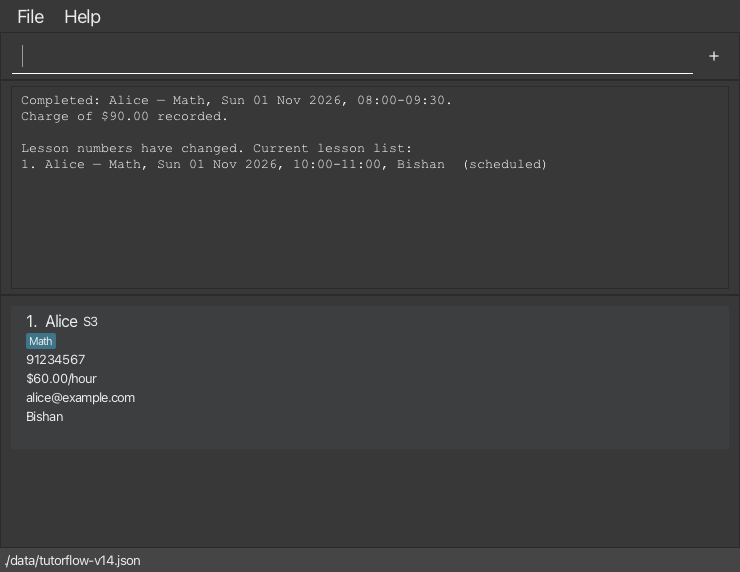
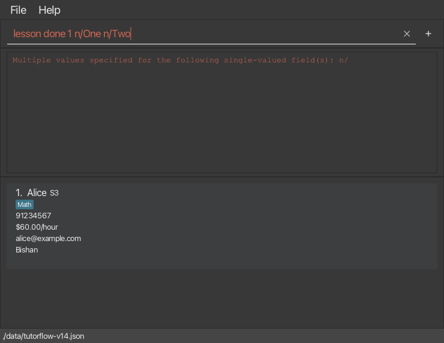
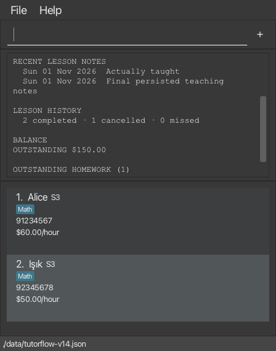

# Lesson and correction testing: 1 November 2026

This is a historical verification record for the exact targets below, not a reusable test plan
or a claim about later commits/releases. The [reusable manual plan](../../../docs/testing/LessonStatusManualTesting.md)
contains the steps and expected results. The [snapshot runner instructions](../README.md) explain
how to reproduce these checks against the published v1.5 JAR.

## Packaged-JAR verification

The following results are from **programmatic command journeys against packaged JAR classes**, not a
claim that every step was clicked in the GUI. The runner invokes the real parser and `LogicManager`,
uses actual JSON files in separate disposable folders, compares saved and live snapshots after each
successful command, and checks both live records and saved bytes after rejected commands. Reopening
checks construct fresh model and logic instances from the saved file. The additional GUI checks below
cover selected rendered workflows; operating-system launch behaviour and other owners' full feature
sets still require their separate checks.

| Target | Result |
|---|---|
| Published v1.5 JAR, SHA-256 `f0e6178c6833087b58669b17fce0b661b9819e6443104fdabd57e552e036d681` | 85 commands; 211 assertions; no failures |
| JAR built from master `3f0ed182` | Same 85 commands and 211 assertions; no failures |
| Focused parser, command, domain, persistence and alpha-correction JUnit tests on that master | 91 tests; no failures, errors or skips |
| Main/test Checkstyle and Shadow JAR build | Passed |

The selected JUnit classes were `*LessonDone*`, `*LessonMissed*`, `LessonStatusTest`,
`JsonAdaptedLessonTest`, `AlphaReportedIssuesTest` and `HomeworkFeedbackCommandTest`.
Passing these checks does not establish that all of TutorFlow is bug-free. In particular, the separate
finance/startup defect in issue #252 is outside these passing lesson/correction journeys.

### Additional GUI verification on 1 November 2026

The unmodified published v1.5 JAR was also launched with its real `MainApp`, FXML controls and
visible JavaFX windows on macOS using Java 25.0.3 FX Zulu. An external GUI integration harness
entered text in the command box and dispatched synthetic Enter key events through its normal
event handling. It inspected the actual result area, card labels and error styles after render
pulses, and captured the rendered scenes. It did **not** call `LogicManager.execute` directly.
These are automated GUI integration checks, not a claim of human mouse/keyboard testing.

| GUI run | Command scenarios | Assertions | Result |
|---|---:|---:|---|
| Empty launch and lesson/correction journeys | 46 | 319 | Passed |
| Separate process reopening the saved records | 6 | 51 | Passed |
| Card controls and offline help | 2 | 26 | Passed |

The runs checked completion charges, no duplicate billing, missed-to-completed correction, refreshed
lesson numbers, future/cancelled rejections, student-card refresh after clearing optional fields,
homework feedback clearing, Unicode filtering, command history, and retaining failed input with
error styling. A 1,000-character note was accepted through the GUI; 1,001 and 200,000 characters
were rejected without changing the saved bytes, and a subsequent valid command succeeded.

Separate process startup restored the notes, lesson states, $150.00 balance, submitted homework
without feedback, and cleared contact fields. The normal window-close handler and the `exit`
command both closed the window. Card shortcuts prepared drafts without changing data; Cancel
cleared an unchanged generated draft while preserving text edited by the user. F1 opened the
bundled offline guide. The command/result controls remained usable at the 450-by-600 minimum
window size. No uncaught application/UI exception was observed in these runs.

These are unedited captures of the JavaFX scene, excluding the operating-system window frame:

